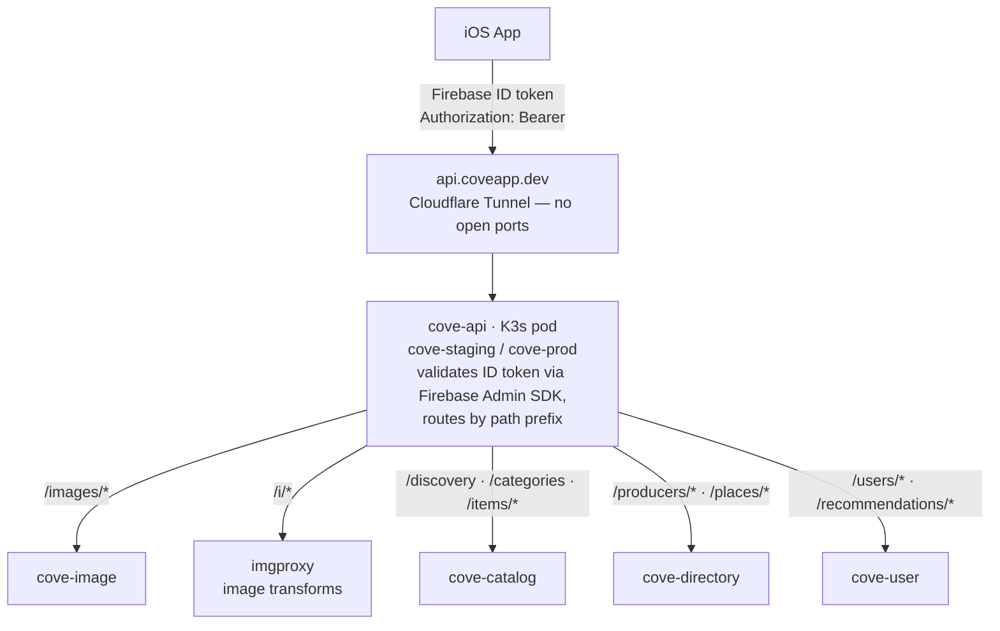

# Backend Infrastructure

> **Status:** Phases 0–3 complete. The cluster is fully bootstrapped and running. `cove-api`, `cove-image`, `cove-item` and `cove-user` run in `cove-staging` and `cove-prod` behind the Cloudflare Tunnel. Epic #393 splits `cove-item` into `cove-catalog` and `cove-directory` in this repo (#413); they replace it on the cluster with #415 and #416. Firebase Storage and Firestore have been retired; all structured data is served from Postgres via the cove-api gateway.

## Contents

- [Architecture](#architecture)
- [Platform layer (installed, Phase 0)](#platform-layer-installed-phase-0)
- [Repo structure](#repo-structure)
- [Service naming](#service-naming)
- [Container images](#container-images)
- [Migration phases](#migration-phases)
- [Manifest conventions](#manifest-conventions)
- [K3s → GKE migration path](#k3s--gke-migration-path)
- [References](#references)

---

## Architecture

> The backend runs on a personal K3s cluster (zero hosting cost), exposed via Cloudflare Tunnel, managed GitOps with Argo CD. Manifests are written to run on GKE unchanged if the cluster needs to move to the cloud.



Firebase Auth is the only GCP dependency in the request path. There is no GCP API Gateway, no Cloud Run, no Cloud SQL.

---

## Platform layer (installed, Phase 0)

The cluster runs on a single-node K3s machine (AMD Ryzen 9600X, 64 GB RAM). Every operator is managed by Argo CD watching the [`homelab`](https://github.com/danicajiao/homelab) repo.

| Operator | Purpose | Namespace |
|---|---|---|
| Argo CD | GitOps reconciler — watches `homelab` repo, applies changes | `argocd` |
| External Secrets Operator | Syncs GCP Secret Manager → K8s Secrets | `external-secrets` |
| CloudNativePG (CNPG) | Manages Postgres `Cluster` CRDs | `cnpg-system` |
| Garage | S3-compatible object storage (`cove-media`, `postgres-backups`, `loki` buckets) | `garage` |
| imgproxy | On-the-fly image resizing and re-encoding from Garage S3 sources | `cove-staging` / `cove-prod` |
| kube-prometheus-stack | Prometheus + Grafana + Alertmanager | `monitoring` |
| Loki + Alloy | Log aggregation (Alloy tails pod logs → Loki, 14d retention) | `monitoring` |
| Cloudflare Tunnel | Exposes `api.coveapp.dev` → cluster without open ports | `cloudflare-tunnel` |

### Secrets

All real secret values live in **GCP Secret Manager**, split across two projects:

| Project | Secrets for |
|---|---|
| `cove-6a685` | Cove workloads — Garage `cove-media` credentials, service API keys |
| `homelab-495921` | Homelab infra — Grafana admin password, Cloudflare Tunnel credentials, Loki Garage credentials |

**Consumer-owns rule:** a secret lives in the GCP project of whatever workload consumes it. The ESO `ClusterSecretStore` for each project (`gcp-cove`, `gcp-homelab`) bridges GCP SM to K8s Secrets via `ExternalSecret` manifests in the relevant namespace.

---

## Repo structure

All buildable units live in this repo (`danicajiao/cove`). Deployment manifests live in a separate repo (`danicajiao/homelab`) that Argo CD watches.

```
danicajiao/cove                 ← all source code and docs
│
├── apps/
│   ├── ios/                    ← Swift / SwiftUI iOS app
│   └── web/                    ← (planned)
│
├── services/
│   ├── cove-api/               ← cove-api gateway service (Phase 1, deployed)
│   ├── cove-image/             ← cove-image service (Phase 2, deployed)
│   ├── cove-catalog/           ← categories, items and discovery (Phase 3; split out of cove-item in #413)
│   ├── cove-directory/         ← producers and places (split out of cove-item in #413)
│   └── cove-user/              ← user profiles + recommendations service (Phase 3, complete)
│
├── packages/                   ← shared code (API schema, types — as needed)
└── docs/

danicajiao/homelab              ← cluster infra (GitOps source for Argo CD)
│
├── infra/                      ← platform operators (one directory per operator)
│   ├── argocd/
│   ├── external-secrets/
│   ├── cnpg/
│   ├── garage/
│   ├── kube-prometheus-stack/
│   ├── loki/
│   ├── alloy/
│   └── cloudflare-tunnel/
│
├── apps/cove/                  ← Cove K8s manifests
│   ├── base/                   ← shared Deployments, Services, etc.
│   └── overlays/
│       ├── staging/            ← cove-staging namespace, staging image tags
│       └── prod/               ← cove-prod namespace, prod image tags
│
└── argocd/                     ← Argo CD Application manifests (app-of-apps)
```

### Build approach

Each service is built independently — no unified build tool required at this scale. The pattern:

- **Each service has its own `Dockerfile`** at `services/cove-<service>/Dockerfile`
- **GitHub Actions** builds and pushes each service's image on changes to its path (path filters prevent rebuilding unrelated services — see `.github/workflows/ci-services.yml`)
- **iOS** keeps its existing Fastlane CI lane
- **Local development** runs the Go binary directly (`go run ./cmd/...`) — no Docker builds required locally

---

## Service naming

Services drop the `-svc` suffix. The pod, K8s Service, and image name are all the same:

| Service | What it does | Phase |
|---|---|---|
| `cove-api` | BFF gateway — validates Firebase token, routes to backend services | Phase 1 (deployed) |
| `cove-image` | Image upload (`POST /images`), signed-URL serving (`GET /images/{filename}/url`), normalization to WebP, content-addressed storage in Garage | Phase 2 (deployed) |
| `cove-catalog` | Categories, items, signals, `GET /discovery` endpoint. Owns the `catalog` schema | Phase 3 (split out in #413) |
| `cove-directory` | Producers and places, `GET /producers/{id}`, `GET /places/{id}`. Owns the `directory` schema | Split out of `cove-item` in #413 |
| `cove-user` | User profiles, interests, `GET /recommendations/categories`, `POST /users/me/activity` | Phase 3 (complete) |

In Kubernetes, each service runs as a `Deployment` in `cove-staging` or `cove-prod`, with a matching `Service` of the same name.

---

## GitHub Actions → GCP authentication (Workload Identity Federation)

GitHub Actions workflows that push container images to Artifact Registry authenticate to GCP using **Workload Identity Federation (WIF)** — no long-lived service account JSON key is stored anywhere.

### How it works

Instead of a key file, GCP trusts GitHub's identity provider directly. When a workflow job starts, GitHub issues it a signed JWT proving "I am a job in repo `danicajiao/cove`, on branch `main`". GCP verifies that signature against GitHub's public OIDC endpoint and exchanges it for a short-lived access token (1 hour). When the job ends the token is already expired — nothing to rotate or leak.

```
GitHub Actions job
    │  OIDC token: "repo:danicajiao/cove, ref:refs/heads/main"
    │  signed by GitHub's identity provider
    ▼
GCP Workload Identity Federation
    │  verifies signature + checks attribute conditions
    │  (only danicajiao/cove on main can impersonate this SA)
    ▼
Short-lived GCP access token (expires in 1 hour)
    │
    ▼
Artifact Registry push (us-central1-docker.pkg.dev/cove-6a685/services/*)
```

### One-time GCP setup

Run these commands once in your terminal (requires `gcloud` CLI authenticated as a project owner):

```bash
PROJECT_ID="cove-6a685"
PROJECT_NUMBER=$(gcloud projects describe $PROJECT_ID --format="value(projectNumber)")
POOL_ID="github-actions"
PROVIDER_ID="github"
SA_NAME="github-actions-ci"
REPO="danicajiao/cove"

# 1. Create the Workload Identity Pool
gcloud iam workload-identity-pools create $POOL_ID \
  --project=$PROJECT_ID \
  --location=global \
  --display-name="GitHub Actions"

# 2. Add GitHub as an OIDC provider inside that pool
gcloud iam workload-identity-pools providers create-oidc $PROVIDER_ID \
  --project=$PROJECT_ID \
  --location=global \
  --workload-identity-pool=$POOL_ID \
  --issuer-uri="https://token.actions.githubusercontent.com" \
  --attribute-mapping="google.subject=assertion.sub,attribute.repository=assertion.repository" \
  --attribute-condition="assertion.repository=='${REPO}'"

# 3. Create the service account CI will impersonate
gcloud iam service-accounts create $SA_NAME \
  --project=$PROJECT_ID \
  --display-name="GitHub Actions CI"

# 4. Grant the service account permission to push to Artifact Registry
gcloud projects add-iam-policy-binding $PROJECT_ID \
  --member="serviceAccount:${SA_NAME}@${PROJECT_ID}.iam.gserviceaccount.com" \
  --role="roles/artifactregistry.writer"

# 5. Allow the GitHub Actions identity to impersonate the service account
gcloud iam service-accounts add-iam-policy-binding \
  "${SA_NAME}@${PROJECT_ID}.iam.gserviceaccount.com" \
  --project=$PROJECT_ID \
  --role="roles/iam.workloadIdentityUser" \
  --member="principalSet://iam.googleapis.com/projects/${PROJECT_NUMBER}/locations/global/workloadIdentityPools/${POOL_ID}/attribute.repository/${REPO}"
```

### Get the values for GitHub repository variables

After running the commands above, retrieve the two values needed by the workflow:

```bash
# WIF_PROVIDER — paste this into GitHub → Settings → Variables → WIF_PROVIDER
echo "projects/${PROJECT_NUMBER}/locations/global/workloadIdentityPools/${POOL_ID}/providers/${PROVIDER_ID}"

# WIF_SERVICE_ACCOUNT — paste this into GitHub → Settings → Variables → WIF_SERVICE_ACCOUNT
echo "${SA_NAME}@${PROJECT_ID}.iam.gserviceaccount.com"
```

These go in **Variables** (not Secrets) in GitHub → Settings → Secrets and variables → Actions → Variables tab. They are not sensitive — they identify the WIF pool, not a credential.

---

## Token validation strategy

**Decision: trust the gateway, propagate UID via header.**

`cove-api` is the only service that validates Firebase ID tokens. After successful validation it forwards the caller's UID to downstream services as an `X-Cove-Uid` HTTP header. Downstream services (`cove-image`, `cove-catalog`, `cove-directory`, `cove-user`) read the header and trust it — they do not re-validate the Bearer token.

```
iOS App
  │  Authorization: Bearer <Firebase ID token>
  ▼
cove-api
  │  validates token via Firebase Admin SDK
  │  X-Cove-Uid: <uid>          ← injected, Bearer token stripped
  ▼
cove-image / cove-catalog / cove-directory / cove-user
     reads X-Cove-Uid from header, no Firebase SDK required
```

### Why this is safe

Downstream services are never exposed to public traffic. They are reachable only via in-cluster Kubernetes Service DNS (`cove-image.cove-staging.svc.cluster.local`). An attacker on the public internet cannot send a forged `X-Cove-Uid` header — they can only reach `cove-api` via Cloudflare Tunnel, and `cove-api` overwrites the header on every request regardless of what the client sent.

NetworkPolicy manifests (added in `danicajiao/homelab#25`) enforce this at the cluster level: downstream services only accept traffic from `cove-api`, not from arbitrary pods. (Note: K3s ships with flannel, which does not enforce NetworkPolicy — these manifests are declarative intent that becomes active if the cluster migrates to a policy-enforcing CNI such as Cilium or Calico.)

### Implementation pattern

`cove-api` — `uidProxy` wraps `httputil.NewSingleHostReverseProxy` and injects the UID from context (set by auth middleware) before forwarding. Any client-supplied `X-Cove-Uid` is overwritten by the `Set` call:

```go
return http.HandlerFunc(func(w http.ResponseWriter, r *http.Request) {
    if uid, ok := covauth.UIDFromContext(r.Context()); ok {
        r.Header.Set("X-Cove-Uid", uid)
    }
    proxy.ServeHTTP(w, r)
})
```

Downstream service middleware (`UIDMiddleware` in each service — replaces Firebase Admin SDK token validation):

```go
func UIDMiddleware(next http.Handler) http.Handler {
    return http.HandlerFunc(func(w http.ResponseWriter, r *http.Request) {
        if r.Header.Get("X-Cove-Uid") == "" {
            w.Header().Set("Content-Type", "application/json")
            w.WriteHeader(http.StatusUnauthorized)
            _, _ = w.Write([]byte(`{"error":"unauthorized"}`))
            return
        }
        next.ServeHTTP(w, r)
    })
}
```

### When to revisit

Revisit if any of the following change:

- A downstream service gains a public ingress (even temporarily)
- The cluster moves to multi-tenant infrastructure (GKE, shared node pools)
- A security audit flags lateral movement risk within the cluster

At that point, replacing the `X-Cove-Uid` header with an internal JWT signed by a cluster secret provides defence-in-depth without requiring the Firebase Admin SDK in every downstream service.

---

## Container images

Images are stored in Google Artifact Registry under the `cove-6a685` project:

```
us-central1-docker.pkg.dev/cove-6a685/services/cove-api:sha-abc1234
us-central1-docker.pkg.dev/cove-6a685/services/cove-image:sha-abc1234
us-central1-docker.pkg.dev/cove-6a685/services/cove-catalog:sha-abc1234
us-central1-docker.pkg.dev/cove-6a685/services/cove-user:sha-abc1234
```

Tags use the Git commit SHA (not `latest`) so every deployed version is traceable. The staging overlay pins the `sha-*` tag from the most recent CI build; the prod overlay promotes the same tag after staging validation.

---

## Migration phases

Each phase is independently shippable. The iOS app is updated incrementally — it never calls a service that isn't deployed.

### Phase 0 — Foundations ✅ complete

- K3s cluster running with Argo CD, ESO, CNPG, Garage, kube-prometheus-stack, Loki, Alloy, Cloudflare Tunnel
- `api.coveapp.dev` resolves to a placeholder response
- `cove-staging` and `cove-prod` namespaces exist, Argo CD overlays wired up
- iOS app still calls Firebase directly — no behavior change

### Phase 1 — Gateway ✅ complete

- Deploy `cove-api` to `cove-staging` and `cove-prod` behind Cloudflare Tunnel
- iOS `CoveAPIClient` sends Firebase ID Token on all requests via `FirebaseAuthMiddleware`
- Gateway validates token, returns typed responses defined in `openapi.yaml`
- iOS app routes all cove-api calls through `CoveAPIClient`; Firebase SDK still used directly for Auth, Firestore, and Storage
- Smoke test: `CoveAPIClient.shared.health()` returns a `HealthResponse` with `status == "ok"`

### Phase 2 — Image service ✅ complete

- `cove-image` deployed to `cove-staging` and `cove-prod`
- `POST /images` — accepts JPEG/PNG/WebP, normalizes to WebP quality 90, strips EXIF (including GPS), stores content-addressed object in Garage `cove-media` bucket (`images/<sha256>.webp`)
- `GET /images/{filename}/url` — generates a short-lived HMAC-SHA256 signed imgproxy URL (1 hr TTL); interim mechanism until `cove-catalog` embeds pre-signed URLs in Phase 3
- `cove-api` proxies `/images/*` to `cove-image` and `/i/*` to imgproxy
- iOS app loads all images via `CoveAPIClient.imageURL(filename:width:height:)` through the `ImageRepository` protocol; `CoveAPIImageRepository` is the active implementation
- Firebase Storage fully retired; `FirebaseStorage` unlinked from the iOS Xcode target
- Firestore `products.defaultImageURL` and `brands.imageURL` now store Garage keys (`images/<sha256>.webp`) instead of `gs://` URLs

### Phase 3 — Data services ✅ complete

See [Marketplace Architecture](MARKETPLACE_ARCHITECTURE.md) for the canonical schema (producer / place / item / signals) and full data model.

- Provision a single CNPG `Cluster` (`cove-db`, with PostGIS + ltree) hosting the `cove` database with three schemas: `directory`, `catalog`, and `profile`. The `directory` schema (producers + places) is pre-positioned for a future `cove-directory` service — no service owns it in Phase 3. PostGIS enables radius-based discovery queries.
- `profile.user_flags` migration added to `cove-db`
- Deploy `cove-catalog` (item ingestion, `GET /discovery` endpoint) and `cove-user` (user profiles, interests, `GET /recommendations/categories`, `POST /users/me/activity`) to `cove-staging`; the prod overlay keeps both at `sha-placeholder` until the integration branch merges to `main`, at which point `ci-services.yml` promotes them to `cove-prod`
- Postgres replaces Firestore for all structured data; cross-schema foreign keys preserve referential integrity for user-centric features (favorites, follows, interests)
- iOS app calls `api.coveapp.dev/discovery`, `api.coveapp.dev/recommendations/*`, `api.coveapp.dev/users/*`, and `api.coveapp.dev/categories`
- Firestore retired upon completion

### Phase 4 (planned) — Self-serve directory

`cove-directory` exists since #413 and owns the `directory` schema, with data seeded by migrations. Not yet planned in detail; tracked separately. Scope:

- Self-serve onboarding flow (producer + place, business/individual verification)
- Producer and place profile management; trust-signal verification
- Producer-facing dashboard API (separate iOS/web surface)

---

## Manifest conventions

Follow these in every service manifest:

- **Always set resource requests and limits** — required for Prometheus to track resource usage; also required by GKE Autopilot if the cluster ever migrates
- **Externalize all config** via `ConfigMap` and `Secret` — no hardcoded endpoints or credentials in images
- **Use Kustomize overlays** for environment differences (image tag, replica count, resource limits)
- **Never hardcode namespace** in base manifests — Kustomize overlays set `namespace:` at the overlay level
- **One Deployment per service** — no sidecars except where explicitly justified (e.g., a metrics exporter)

---

## K3s → GKE migration path

K3s uses the same Kubernetes API as GKE — manifests written today run on GKE unchanged. If the cluster ever needs to move:

1. Images are already in Google Artifact Registry — no changes
2. Provision a GKE cluster
3. Apply existing Kustomize configs with a new `overlays/gke/` overlay
4. Update Cloudflare Tunnel to point at the GKE cluster's internal Service
5. Decommission K3s

---

## References

- [Postgres Primer](POSTGRES_PRIMER.md) — indexes, JSONB, full-text search, ltree, PostGIS
- [Marketplace Architecture](MARKETPLACE_ARCHITECTURE.md) — the canonical data model (entities, trust layer, schemas, discovery query)
- [iOS App Architecture](IOS_APP_ARCHITECTURE.md) — current iOS app structure and Firebase usage
