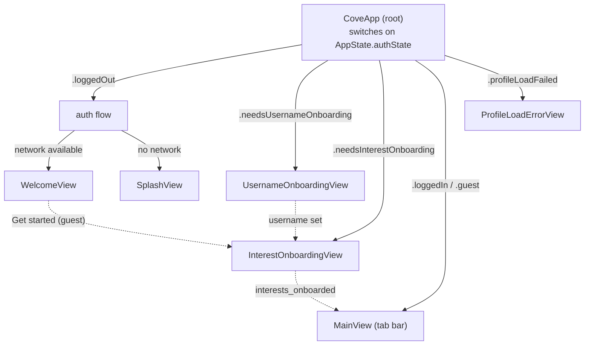
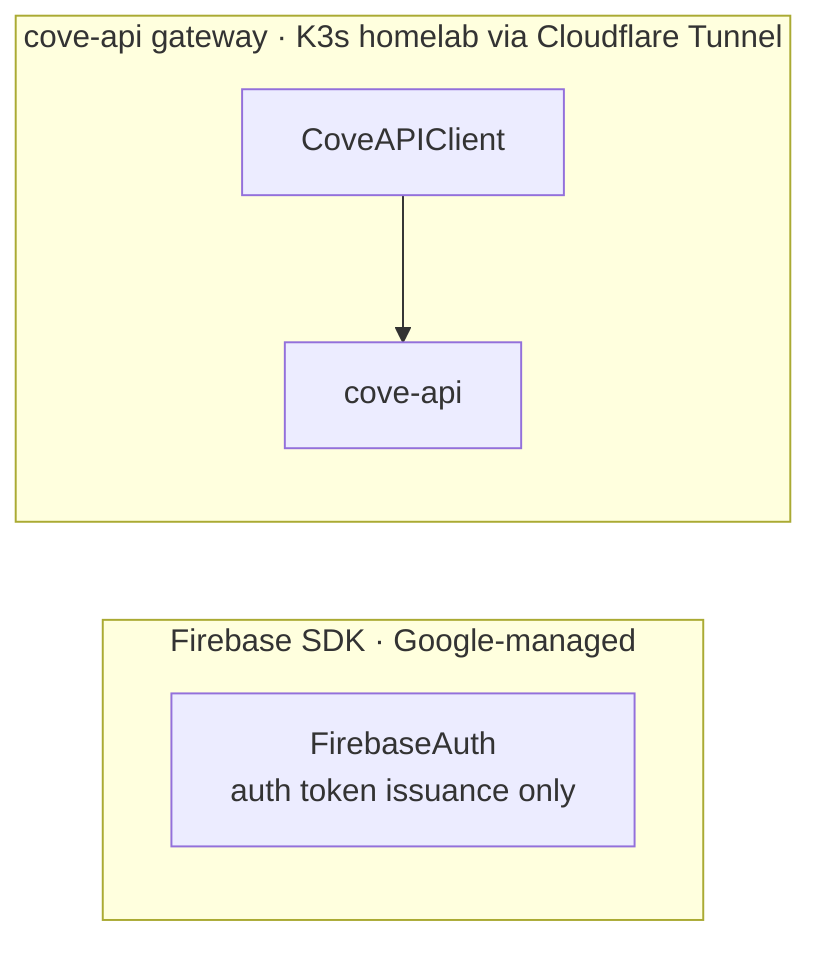
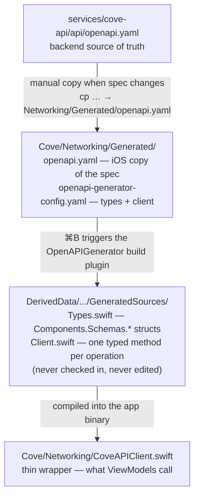
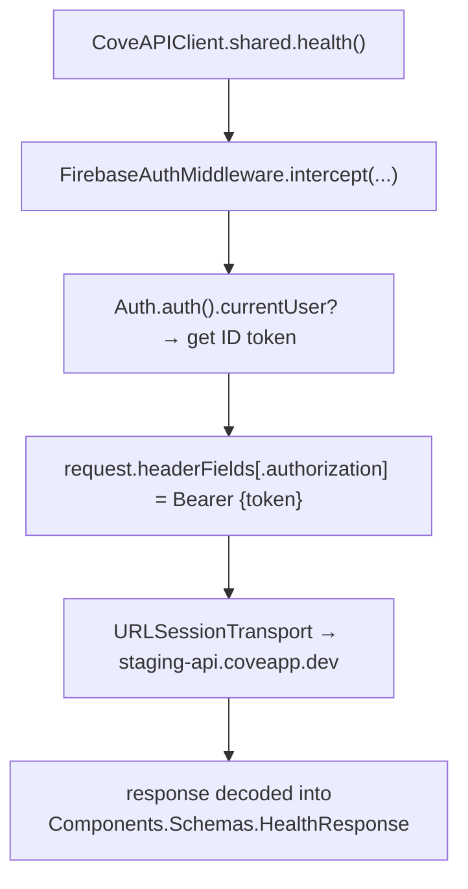

# iOS App Architecture

This document covers the Cove iOS app's architecture — how it's structured, how data flows, and how key systems work.

## Contents

- [Overview](#overview)
- [Project Structure](#project-structure)
- [Authentication & Navigation](#authentication--navigation)
- [Tab Structure](#tab-structure)
- [ViewModels](#viewmodels)
- [Global State](#global-state)
- [Networking](#networking)
- [Item Type System](#item-type-system)
- [Key Data Flows](#key-data-flows)
- [Not Yet Implemented](#not-yet-implemented)
- [Firebase Data Model (historical)](#firebase-data-model-historical)

---

## Overview

Cove uses **MVVM (Model-View-ViewModel)** with SwiftUI. State is managed through a combination of `@StateObject`, `@EnvironmentObject`, and `@Published` properties.

The app talks to two separate backends:
- **Firebase** — Auth (sign-in) only. Accessed directly through the Firebase iOS SDK. Firestore and Firebase Storage were retired in Phase 3.
- **cove-api gateway** — the custom K3s-hosted backend. All calls go through `CoveAPIClient`, which is generated from the gateway's OpenAPI spec. Image loading goes through this path via `CoveAPIImageRepository`.

---

## Project Structure

```
apps/ios/Cove/
├── Supporting Files/     # App entry point (CoveApp.swift), Info.plist
├── Models/               # Data models and global state (AppState, FavoritesStore, TabState, AccountPrompt, DiscoveryItem, etc.)
│                         #   Note: Path, AuthState, AuthMethod enums are defined in AppState.swift;
│                         #   Google and Facebook sign-in are in AppState+SocialSignIn.swift
├── View Models/          # Business logic (HomeViewModel, FavoritesViewModel, etc.)
├── Views/                # SwiftUI views organized by feature
│   ├── Account/          # AccountSheetView (the guest sign-up sheet)
│   ├── Onboarding/       # UsernameOnboardingView, InterestOnboardingView
│   ├── Profile/          # ProfileHeaderView, StatsRowView, ProfileRowView, GuestPromptCardView
│   └── ...               # HomeView, FavoritesView, ItemDetailView, ProfileLoadErrorView, auth views
├── Components/           # Reusable UI components (ItemCard, CategoryCard, LikeButton, OrDivider, etc.)
├── Networking/           # CoveAPIClient, APIEnvironment, repositories, generated OpenAPI spec
├── Styles/               # Custom button styles and shadow modifiers
├── Constants/            # Design token constants (Spacing.swift, Radius.swift) and LevelOneCategories
└── Resources/            # Assets, fonts (Gazpacho, Lato), Rive animations
```

---

## Authentication & Navigation

### Auth-Driven Routing

`CoveApp` is the root of the app. It switches on `AppState.authState` (six cases) to decide which UI to show:



`AppState` holds `@Published var authState: AuthState`:

| Case | Shown | Meaning |
|---|---|---|
| `.loggedOut` | `WelcomeView`, `LoginView` or `SignupView` (`SplashView` with no network) | No Firebase user |
| `.needsUsernameOnboarding` | `UsernameOnboardingView` | Signed-up user with no profile or no username |
| `.needsInterestOnboarding` | `InterestOnboardingView` | Interests not picked yet (guests and signed-up users) |
| `.loggedIn` | `MainView` | Signed-up user, fully onboarded |
| `.guest` | `MainView` | Anonymous Firebase user with a guest profile and interests picked |
| `.profileLoadFailed` | `ProfileLoadErrorView` | Signed in, but the profile couldn't be loaded. Its retry button calls `AppState.retryProfileLoad()` |

`MainView` also stays on screen during `.needsUsernameOnboarding` and `.needsInterestOnboarding` while the sign-up sheet is open (`showsMainView` in `CoveApp.swift`). A guest who signs up from the sheet finishes onboarding inside it and ends up back where they were.

Auth navigation is owned locally by `CoveApp` via `@State private var authScreen: Path?`: `nil` shows `WelcomeView`, `.login` and `.signup` show those screens. It is reset to `nil` via `.onChange(of: appState.authState)` on logout. `WelcomeView` has two buttons: **Get started** starts a guest session (`AppState.startGuestSession`) and **Log in** opens `LoginView`. `SignupView` is reached from `LoginView`.

### Post-sign-in onboarding

A Firebase auth state listener in `AppState.init` calls `handlePostSignIn` whenever a user signs in, and sets `.loggedOut` when the user signs out. `handlePostSignIn` loads the `cove-user` profile (`GET /users/me`) and routes:

- **Guest** (anonymous Firebase user): no profile (404) → create a guest profile with `POST /users/me` and no body; then interests if not picked, then `.guest`. Guests never see username onboarding.
- **Signed-up user**: no profile or no username → `.needsUsernameOnboarding`; then interests if not picked, then `.loggedIn`.
- **Any other error** loading the profile → `.profileLoadFailed`.

For a signed-up user, entry into the app is gated on two `cove-user`-backed checks before reaching `.loggedIn`:

1. **Username** — if the signed-in user has no username, `authState` becomes `.needsUsernameOnboarding` and `UsernameOnboardingView` collects one. A new user's profile is created with `POST /users/me`. A guest who just linked a login already has a profile, so the username is set with `PATCH /users/me` (`AppState.hasProfile` picks between them).
2. **Interests** — `AppState` then loads the profile and reads the `interests_onboarded` flag. If `false`, `authState` becomes `.needsInterestOnboarding` and `InterestOnboardingView` fetches the category tree (`GET /categories`) and shows the level 1 categories as full-width cards with their wide images (`wide_image_key`), in the fixed order and pill colors from `Constants/LevelOneCategories.swift`. Tapping a card selects it and expands its level 2 categories as pills; tapping it again deselects it and clears its pills. Every selected level 1 and level 2 ID is saved via `PUT /users/me/interests` (which sets `interests_onboarded`). If already onboarded, it goes straight to `.loggedIn`.

Once both checks pass, `authState` flips to `.loggedIn` and `MainView` is shown. When interest onboarding finishes, `finishInterestOnboarding()` sets `.guest` for an anonymous user and `.loggedIn` otherwise.

### Supported Auth Methods

| Method | Provider |
|--------|----------|
| Guest | Firebase Auth anonymous sign-in (`signInAnonymously`) |
| Email/Password | Firebase Auth |
| Google | GoogleSignIn SDK → Firebase Auth |
| Facebook | FBSDKLoginKit → Firebase Auth |
| Apple | Planned, not yet implemented. The Apple button (`SmallSocialButton`) only logs the tap |

Google and Facebook sign-in live in `Models/AppState+SocialSignIn.swift`.

### Guest browsing

Guests are anonymous Firebase users with a `cove-user` profile that has no username. They can browse, pick interests and record activity. Favorites and follows need an account: the gateway marks guest requests with `X-Cove-Guest: true`, `cove-user` answers those routes with 403 `account_required`, and `CoveAPIClient` turns that into `CoveAPIError.accountRequired`. See [Guest identity](BACKEND_INFRASTRUCTURE.md#guest-identity) in Backend Infrastructure.

**Linking a login keeps the guest's UID.** When the current user is anonymous, sign-up and log in link the new credential to the guest account instead of signing in:

- `signInOrLink(with:method:onFailure:)` (Google, Facebook) links the credential. If the login already belongs to another account (`credentialAlreadyInUse` or `emailAlreadyInUse`), it signs in to that account instead and the guest's data is dropped. Merging is out of scope.
- `emailSignUp` links an email credential for a guest, with the same fallback to `emailLogIn`.
- After a successful link, the ID token is refreshed so the gateway sees the new sign-in provider, then `handlePostSignIn` routes the user to username onboarding.

**Sign-up sheet.** When a guest tries an account-only action, the view calls `AppState.requireAccount(_:then:)` with an `AccountPrompt` (`.favorite`, `.follow`, `.createAccount` or `.logIn`). `MainView` presents `AccountSheetView` for `appState.accountPrompt`. The sheet starts on a short prompt, or straight on sign-up or log in when opened from the Profile tab. Sign-up, log in, username and interest onboarding all run inside the sheet. When the state reaches `.loggedIn`, the sheet closes and the pending action runs. "Not now", swiping down or signing out cancels it. The sheet can't be swiped away during onboarding.

Today only favoriting uses the sheet. `LikeButton` calls `requireAccount(.favorite)` for a guest and retries with `FavoritesStore.addFavorite`, which only adds, since the account the guest ends up in may already have the item. Follow has no UI yet. If the gateway refuses a favorite with `account_required` anyway, `FavoritesStore.accountRequired` is set and `MainView` opens the sheet without retrying.

**Profile tab.** For a guest, `ProfileView` shows `GuestPromptCardView` (Create account, Log in) in place of the profile header and stats, and hides the Profile and Security and Logins rows. Logging out as a guest asks for confirmation first, since the interest picks are lost.

**Cleanup.** `cove-user` deletes guest profiles idle for more than 30 days (see [Guest identity](BACKEND_INFRASTRUCTURE.md#guest-identity)).

### Navigation Enums

`Path` is defined in `Models/AppState.swift` alongside `AuthState` and `AuthMethod`. `CoveApp` uses its `.login` and `.signup` cases to pick the auth screen; `TabNavigationStack` uses the rest for in-tab navigation via `.navigationDestination(for: Path.self)`:

```swift
enum Path: Hashable {
    case login
    case signup
    case item(id: String)
    /// Discovery results scoped to a category subtree (ltree path + display name).
    case categoryResults(path: String, name: String)
}
```

---

## Tab Structure

`MainView` hosts a `TabView` with 4 tabs. Each tab is wrapped in a `TabNavigationStack` to support in-tab navigation (e.g., tapping an item from the Home tab pushes `ItemDetailView` without leaving the tab).

| Tab | Value | View | Status |
|-----|-----|------|--------|
| Home | `AppTab.home` | `HomeView` | Implemented |
| Browse | `AppTab.browse` | Placeholder `Text` | Not implemented |
| Favorites | `AppTab.favorites` | `FavoritesView` | Implemented |
| Profile | `AppTab.profile` | `ProfileView` | Implemented |

Tab selection is managed by `TabState` (`Models/TabState.swift`) — an `ObservableObject` that tracks `currentTab` and `previousTab` as `AppTab` values.

---

## ViewModels

### HomeViewModel
Serves `HomeView`. Fetches items and brands via `ItemRepository` (`CoveAPIItemRepository`). Items are cached in-memory with a 5-minute TTL; `fetchItems()` early-returns unless the cache is expired or `forceRefresh` is true. Also fetches the home category shelf from `GET /recommendations/categories` via `CoveAPIClient` (`fetchCategories()`): every level 1 category, with the user's picks first, kept in server order. It prefetches each card's signed image URL, and records `category_tap` attention events when a card is tapped.

### ItemDetailViewModel
Serves `ItemDetailView`. Initialized with an `itemId`, it runs three async fetches on init: the item itself, its type-specific details, and up to 5 similar items (same `categoryId`). Also manages `detailSelection` — the currently active tab, Description or About.

### FavoritesViewModel
Serves `FavoritesView`. Fetches the current user's favorited items via the `FavoritesRepository` and `ItemRepository` protocols (backed by `CoveAPIFavoritesRepository` and `CoveAPIItemRepository`). Reads favorite item IDs from `cove-user`, then hydrates each one by fetching the corresponding item from `cove-catalog` through the gateway. Publishes `favorites: [any Item]` and `isLoading`.

### ProfileViewModel
Serves `ProfileView`. Reads display name, initials and photo URL from `Auth.auth().currentUser`, and loads the `cove-user` profile via `UserRepository` (`CoveAPIUserRepository`) in `fetchProfile()`.

---

## Global State

### AppState
Injected at the root via `.environmentObject`. Owns:
- `authState` — drives the root UI split between auth flow and main app
- All sign-in/sign-out methods for every auth provider, including `startGuestSession`, `signInOrLink` and guest linking in `emailSignUp`
- `accountPrompt` and `requireAccount(_:then:)` — the guest sign-up sheet and the action to retry after sign-up
- `isGuest` — true while the Firebase user is anonymous

### FavoritesStore
Injected at the root (`CoveApp`) via `.environmentObject` and available throughout the entire app. Owns:
- `favoriteIds: Set<String>` — the set of favorited item IDs for the current user
- `isTogglingFavorite: Bool` — prevents concurrent toggle operations
- Listens to `Auth.auth().addStateDidChangeListener` to load favorites on sign-in and clear them on sign-out. Guests (anonymous users) never load favorites
- `toggle(_:categoryId:)` — optimistically updates `favoriteIds` locally, then syncs to `cove-user` via `CoveAPIFavoritesRepository` (`POST`/`DELETE /users/me/favorites/{itemId}`)
- `addFavorite(_:categoryId:)` — adds an item only if it isn't already a favorite. Used to retry a guest's favorite after sign-up
- `accountRequired: Bool` — set when the gateway refuses a favorite with `account_required`
- Used by `LikeButton` to read and mutate favorite state across all views

---

## Networking

The app has two completely separate networking tracks. They never share code.



`CoveAPIClient` is the sole path to the gateway — all calls go through it, including image loading via `CoveAPIImageRepository`. The two tracks never share code; the Firebase ID token issued on the left is attached as a `Bearer` header to requests on the right.

### APIEnvironment

`APIEnvironment` selects the server URL at compile time:

```swift
// Debug builds → staging-api.coveapp.dev
// Release builds → api.coveapp.dev
static var current: APIEnvironment {
    #if DEBUG
        return .staging
    #else
        return .production
    #endif
}
```

This means TestFlight builds hit staging automatically; App Store builds hit production. No runtime toggle, no Info.plist key.

---

### CoveAPIClient

`CoveAPIClient` is the only path the iOS app uses to call cove-api. It wraps a generated `Client` struct produced by `swift-openapi-generator` from the gateway's OpenAPI spec.

**How the generation works:**



The generated files live in DerivedData and are never committed. They recompile automatically whenever `openapi.yaml` changes.

**What `CoveAPIClient` adds on top of the generated `Client`:**

| Concern | How it's handled |
|---|---|
| Server URL | `APIEnvironment.current.baseURL` — staging in Debug, prod in Release |
| Auth | `FirebaseAuthMiddleware` injects `Authorization: Bearer <token>` on every request |
| Response unwrapping | Each method switches over the generated response enum and returns a plain Swift type |
| Errors | `CoveAPIError` (`Networking/CoveAPIError.swift`): `.unexpectedStatus(Int)`, `.invalidResponseBody(String)`, and `.accountRequired` for a guest's 403 on favorites and follows |
| Shared instance | `CoveAPIClient.shared` for standard use; injectable `serverURL` + `session` for tests |

**Calling an endpoint:**

```swift
// What a ViewModel or repository calls:
let health = try await CoveAPIClient.shared.health()
// health.service == "cove-api"
// health.status  == "ok"
// health.commit  == "a3f8c12"
```

---

### FirebaseAuthMiddleware

A `ClientMiddleware` that runs on every outgoing request to cove-api. It fetches the current Firebase user's ID token and injects it as a Bearer header before forwarding the request.



Routes that opt out of auth (e.g. `GET /health`) receive the header anyway — the gateway ignores it. This keeps the middleware unconditional with no per-route branching.

If no user is signed in the request is forwarded without a header. Unauthenticated routes continue to work; protected routes receive a 401 from the gateway.

---

### Adding a new gateway endpoint

When a new route is added to cove-api:

1. Backend adds the route to `services/cove-api/api/openapi.yaml`
2. Copy the updated spec into iOS:
   ```bash
   cp services/cove-api/api/openapi.yaml apps/ios/Cove/Networking/Generated/openapi.yaml
   ```
3. Build (`⌘B`) — the plugin regenerates `Types.swift` and `Client.swift`
4. Add a method to `CoveAPIClient.swift` that calls the generated method and unwraps the response

---

### ImageRepository — protocol and active implementation

Image loading is abstracted behind the `ImageRepository` protocol (`Networking/Repositories/ImageRepository.swift`). Views access it through the SwiftUI environment. The environment key defaults to `CoveAPIImageRepository()`, and `CoveApp` also injects it explicitly on `MainView()` whenever the main app is shown.

```swift
// Protocol — key-based: takes the Garage object key directly
protocol ImageRepository: Sendable {
    func imageURL(for key: String) async throws -> URL
}
```

The environment key provides a default of `CoveAPIImageRepository()`, so views receive the correct implementation without explicit injection at each call site. Tests and Previews override it with a mock via `.environment(\.imageRepository, mock)`.

**`CoveAPIImageRepository`** is the active implementation. It:
1. Strips the `images/` prefix from the Garage key to get the bare filename
2. Calls `api.imageURL(filename:width:height:)` on the injected `CoveAPIClient` (defaults to `.shared`) — the `GET /images/{filename}/url` gateway endpoint
3. Returns the signed imgproxy URL ready for `AsyncImage`

`FirebaseImageRepository` was removed in Phase 2. There are no remaining references to Firebase Storage in the iOS codebase.

---

## Item Type System

Items are modelled by two protocols in `Models/`: `Item` (list and card data) and `ItemDetails` (the detail screen). Every item from the gateway is a `DiscoveryItem`, built from `GET /discovery` and `GET /items/{id}`; its details are a `DiscoveryItemDetails`. `CoveAPIItemRepository` returns these from every method, so views read fields such as `name`, `madeBy`, `places` and the pre-signed image variants directly, with no downcasting by category.

Category-specific types (coffee, music, apparel) and `ProductTypes.swift` were removed in Phase 3. Categories are data now, served by `GET /categories`. `ExampleItem` in `Models/Item.swift` is a placeholder conformance.

---

## Key Data Flows

### App Launch → Items Displayed

```
1. CoveApp checks authState → .loggedIn
2. MainView shown with HomeView in first tab
3. HomeView.onAppear → viewModel.fetchCategories() + viewModel.fetchItems() + viewModel.fetchBrands()
4. CoveAPIItemRepository → GET /discovery (via CoveAPIClient)
5. Each result decoded into a DiscoveryItem
6. items array published → HomeView renders ItemCard grid
7. brands array published → HomeView renders brand logo row
8. categories array published → HomeView renders CategoryCard scroll row
```

### Item Tap → Detail View

```
1. User taps ItemCard
2. NavigationLink(value: Path.item(id:)) fires
3. TabNavigationStack routes to ItemDetailView(itemId:)
4. ViewModel init → async fetch: item + details + similar items
5. UI renders with Description / About tabs
```

### Sign Out

```
1. User taps "Log Out" in ProfileView → confirmation alert ("Log out of guest mode?" for a guest)
2. appState.logOut() called (works for every provider, including guests)
3. Firebase Auth signOut()
4. Provider-specific cleanup when that provider was linked (GIDSignIn.signOut() / LoginManager().logOut())
5. authState = .loggedOut → CoveApp resets authScreen = nil → WelcomeView shown
```

---

## Not Yet Implemented

| Feature | Location |
|---------|----------|
| Browse tab | Placeholder `Text` in `MainView` |
| Search | `TextField` in `HomeView` is present but not connected |
| Reviews | `NavigationLink` exists in `ItemDetailView` but no destination |
| Profile editing | `ProfileRowView` items are not wired up |
| Notifications | Bell icon in `HomeView` has no action |
| Apple Sign-In | `AuthMethod.apple` referenced and the Apple button only logs the tap; sign-in flow not implemented |
| Follow | `cove-user` follow routes and `AccountPrompt.follow` exist, but there is no follow UI yet |

---


## Firebase Data Model (historical)

> **Retired in Phase 3.** Firestore is no longer used for structured data. This section is preserved for reference when reviewing git history or understanding legacy code.

### Collections

| Collection | Purpose |
|------------|---------|
| `products` | All product listings |
| `product_details` | Type-specific product details (keyed by `productDetailsId`) |
| `brands` | Brand/store info shown in the Home "Stores" section |
| `users/{uid}/favorites` | Per-user favorited product IDs |

### Product Document Structure

```
products/{productId}
  ├── categoryId: String          // Firestore-era field; replaced by ltree category path in Phase 3
  ├── defaultPrice: Float
  ├── defaultImageURL: String     // Garage object key, e.g. "images/<sha256>.webp"
  ├── productDetailsId: String    // Foreign key to product_details
  ├── isFavorite: Bool?           // Set client-side after favorites query
  ├── createdAt: Timestamp
  └── info: { ... }              // Type-specific nested object
```

Note: `defaultImageURL` previously held a Firebase Storage `gs://` URL. As of Phase 2 it holds a Garage object key (`images/<sha256>.webp`). The same key format applies to `brands.imageURL`.

### Image Loading

Product images were loaded from Firestore document keys and resolved to signed imgproxy URLs via `CoveAPIImageRepository`. Firebase Storage was retired in Phase 2; `FirebaseImageRepository` is removed.
