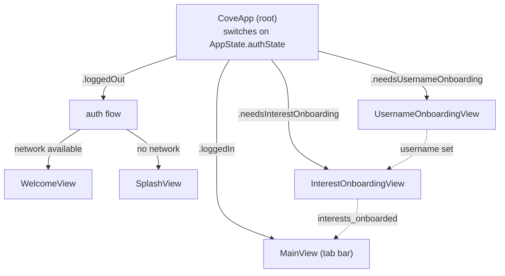
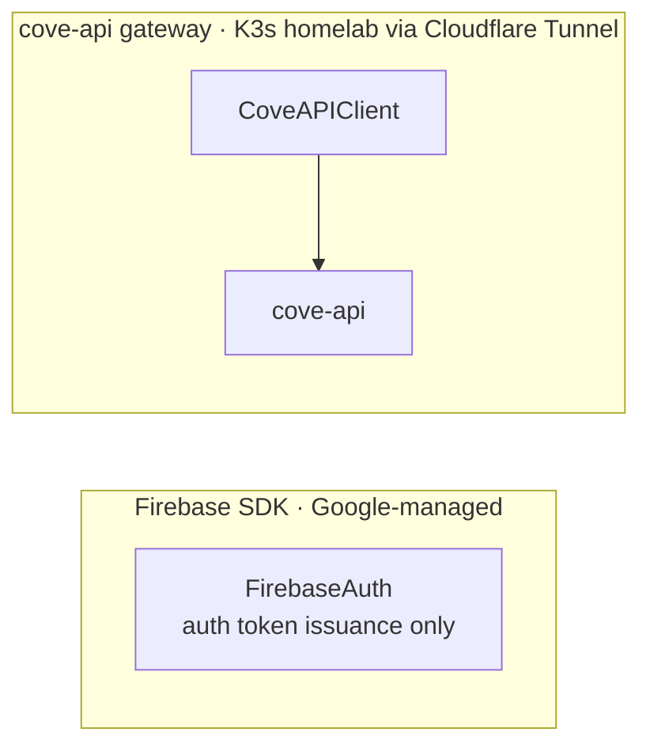
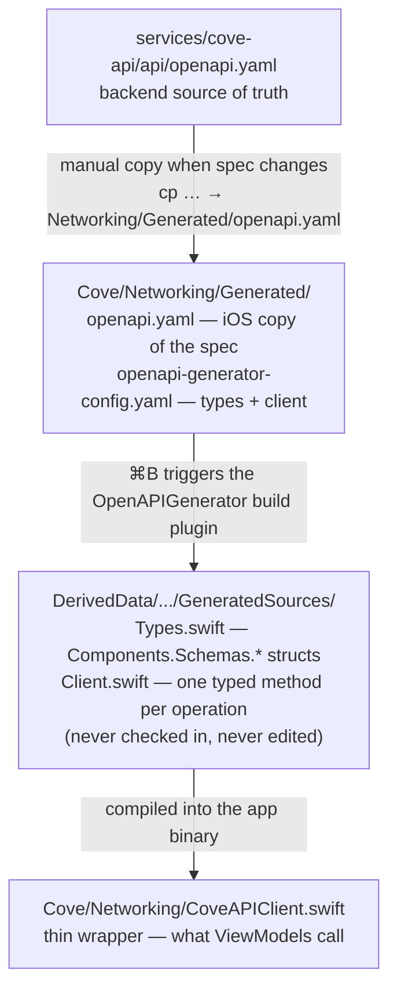
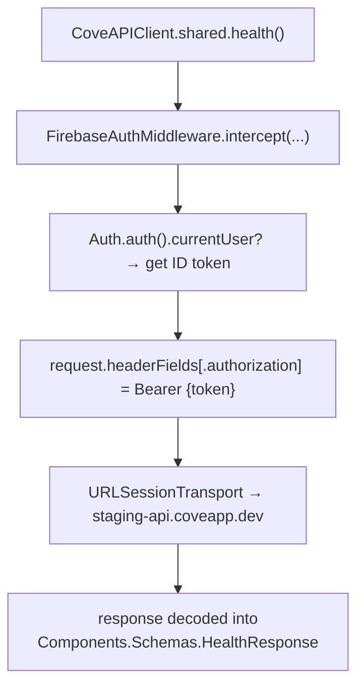

# iOS App Architecture

This document covers the Cove iOS app's architecture — how it's structured, how data flows, and how key systems work.

## Contents

- [Overview](#overview)
- [Project Structure](#project-structure)
- [Authentication & Navigation](#authentication--navigation)
- [Tab Structure](#tab-structure)
- [ViewModels](#viewmodels)
- [Global State](#global-state)
- [Networking](#networking)
- [Item Type System](#item-type-system)
- [Key Data Flows](#key-data-flows)
- [Not Yet Implemented](#not-yet-implemented)
- [Firebase Data Model (historical)](#firebase-data-model-historical)

---

## Overview

Cove uses **MVVM (Model-View-ViewModel)** with SwiftUI. State is managed through a combination of `@StateObject`, `@EnvironmentObject`, and `@Published` properties.

The app talks to two separate backends:
- **Firebase** — Auth (sign-in) only. Accessed directly through the Firebase iOS SDK. Firestore and Firebase Storage were retired in Phase 3.
- **cove-api gateway** — the custom K3s-hosted backend. All calls go through `CoveAPIClient`, which is generated from the gateway's OpenAPI spec. Image loading goes through this path via `CoveAPIImageRepository`.

---

## Project Structure

```
apps/ios/Cove/
├── Supporting Files/     # App entry point (CoveApp.swift), Info.plist
├── Models/               # Data models and global state (AppState, Bag, TabState, etc.)
│                         #   Note: Path, AuthState, AuthMethod enums are defined in AppState.swift
├── View Models/          # Business logic (HomeViewModel, FavoritesViewModel, etc.)
├── Views/                # SwiftUI views organized by feature
│   ├── Profile/          # ProfileHeaderView, StatsRowView, ProfileRowView
│   └── ...               # HomeView, BagView, ItemDetailView, auth views
├── Components/           # Reusable UI components (ItemCard, CategoryCard, LikeButton, etc.)
├── Styles/               # Custom button styles and shadow modifiers
├── Enums/                # AuthPath (ProductTypes removed in Phase 3)
├── Constants/            # Design token constants (Spacing.swift, Radius.swift)
└── Resources/            # Assets, fonts (Gazpacho, Lato), Rive animations
```

---

## Authentication & Navigation

### Auth-Driven Routing

`CoveApp` is the root of the app. It switches on `AppState.authState` (four cases) to decide which UI to show:



`AppState` holds `@Published var authState: AuthState` (`.loggedOut`, `.needsUsernameOnboarding`, `.needsInterestOnboarding`, `.loggedIn`). Auth navigation is owned locally by `CoveApp` via `@State private var authPath: [AuthPath]`, which is reset to `[]` via `.onChange(of: appState.authState)` on logout.

### Post-sign-in onboarding

After Firebase sign-in, `AppState` gates entry into the app on two `cove-user`-backed checks before reaching `.loggedIn`:

1. **Username** — if the signed-in user has no username, `authState` becomes `.needsUsernameOnboarding` and `UsernameOnboardingView` collects one (persisted via `cove-user`, `POST /users/me`).
2. **Interests** — `AppState` then loads the profile and reads the `interests_onboarded` flag. If `false`, `authState` becomes `.needsInterestOnboarding` and `InterestOnboardingView` fetches the category tree (`GET /categories`) and shows the level 1 categories as full-width cards with their wide images (`wide_image_key`), in the fixed order and pill colors from `Constants/LevelOneCategories.swift`. Tapping a card selects it and expands its level 2 categories as pills; tapping it again deselects it and clears its pills. Every selected level 1 and level 2 ID is saved via `PUT /users/me/interests` (which sets `interests_onboarded`). If already onboarded, it goes straight to `.loggedIn`.

Once both checks pass, `authState` flips to `.loggedIn` and `MainView` is shown.

### Supported Auth Methods

| Method | Provider |
|--------|----------|
| Email/Password | Firebase Auth |
| Google | GoogleSignIn SDK → Firebase Auth |
| Facebook | FBSDKLoginKit → Firebase Auth |
| Apple | Planned, not yet implemented |

### Navigation Enums

`AuthPath` drives the auth `NavigationStack` in `CoveApp`. It is defined in `Enums/AuthPath.swift`:

```swift
enum AuthPath: Hashable {
    case login
    case signup
}
```

`Path` drives in-app navigation within `TabNavigationStack`. It is defined in `Models/AppState.swift` alongside `AuthState` and `AuthMethod`:

```swift
enum Path: Hashable {
    case welcome
    case login
    case signup
    case main
    case home
    case item(id: String)
}
```

---

## Tab Structure

`MainView` hosts a `TabView` with 5 tabs. Each tab is wrapped in a `TabNavigationStack` to support in-tab navigation (e.g., tapping an item from the Home tab pushes `ItemDetailView` without leaving the tab).

| Tab | Tag | View | Status |
|-----|-----|------|--------|
| Home | `"home"` | `HomeView` | Implemented |
| Browse | `"browse"` | Placeholder `Text` | Not implemented |
| Bag | `"bag"` | `BagView` | Implemented (badge shows item count); planned replacement is VisitList (see below) |
| Favorites | `"favorites"` | `FavoritesView` | Implemented |
| Profile | `"profile"` | `ProfileView` | Implemented |

Tab selection is managed by `TabState` (`Models/TabState.swift`) — an `ObservableObject` that tracks `currentTab` and `previousTab` as `String` values matching the tab tags above.

---

## ViewModels

### HomeViewModel
Serves `HomeView`. Fetches items and brands via `ItemRepository` (`CoveAPIItemRepository`). Items are cached in-memory with a 5-minute TTL; `fetchItems()` early-returns unless the cache is expired or `forceRefresh` is true. Also fetches the home category shelf from `GET /recommendations/categories` via `CoveAPIClient` (`fetchCategories()`): every level 1 category, with the user's picks first, kept in server order. It prefetches each card's signed image URL, and records `category_tap` attention events when a card is tapped.

### ItemDetailViewModel
Serves `ItemDetailView`. Initialized with an `itemId`, it runs three async fetches on init: the item itself, its type-specific details, and up to 5 similar items (same `categoryId`). Also manages `detailSelection` — the currently active tab (Description / Origin / Tracklist / Specifications / About), which varies by item type.

### BagViewModel
Serves `BagView`. Manages the user's bag — products they intend to purchase or revisit. Fetches product recommendations based on the categories of items in the bag.

> **v1 note:** The Bag is a v1 stand-in. Because Cove does not handle fulfillment or transactions in v1, a full cart/checkout model isn't warranted. The planned replacement is **VisitList** — a saved list of items the user intends to visit or purchase, without requiring checkout infrastructure. VisitList will replace `Bag` and `BagViewModel` in a future phase.

### FavoritesViewModel
Serves `FavoritesView`. Fetches the current user's favorited items via the `FavoritesRepository` and `ItemRepository` protocols (backed by `CoveAPIFavoritesRepository` and `CoveAPIItemRepository`). Reads favorite item IDs from `cove-user`, then hydrates each one by fetching the corresponding item from `cove-item`. Publishes `favorites: [any Item]` and `isLoading`.

### ProfileViewModel
Serves `ProfileView`. Lightweight — all data is derived from `Auth.auth().currentUser` (display name, initials, photo URL, member since date). No repository calls, no local state mutations.

---

## Global State

### AppState
Injected at the root via `.environmentObject`. Owns:
- `authState` — drives the root UI split between auth flow and main app
- All sign-in/sign-out methods for every auth provider

### Bag
`Bag` (`Models/Bag.swift`) is injected at the root (`CoveApp`) via `.environmentObject` and available throughout the app. Owns:
- `items: [BagItem]` — products the user has added to their bag
- `totalItems: Int` — computed count used to badge the Bag tab
- `categories: [String]` — categoryIds of items in the bag, used to fetch recommendations in `BagViewModel`

**Planned replacement — VisitList:** `Bag` will be superseded by `VisitList` in a future phase. Since v1 does not include fulfillment or transaction processing, a lightweight "visit list" (items the user wants to remember or visit in person) is a better fit than a purchase cart. `VisitList` will replace `Bag`, `BagItem`, and `BagViewModel`; the tab icon and global state injection point will carry over.

### FavoritesStore
Injected at the root (`CoveApp`) via `.environmentObject` and available throughout the entire app. Owns:
- `favoriteIds: Set<String>` — the set of favorited item IDs for the current user
- `isTogglingFavorite: Bool` — prevents concurrent toggle operations
- Listens to `Auth.auth().addStateDidChangeListener` to load favorites on sign-in and clear them on sign-out
- `toggle(_:categoryId:)` — optimistically updates `favoriteIds` locally, then syncs to `cove-user` via `CoveAPIFavoritesRepository` (`POST`/`DELETE /users/me/favorites/{itemId}`)
- Used by `LikeButton` to read and mutate favorite state across all views

---

## Networking

The app has two completely separate networking tracks. They never share code.



`CoveAPIClient` is the sole path to the gateway — all calls go through it, including image loading via `CoveAPIImageRepository`. The two tracks never share code; the Firebase ID token issued on the left is attached as a `Bearer` header to requests on the right.

### APIEnvironment

`APIEnvironment` selects the server URL at compile time:

```swift
// Debug builds → staging-api.coveapp.dev
// Release builds → api.coveapp.dev
static var current: APIEnvironment {
    #if DEBUG
        return .staging
    #else
        return .production
    #endif
}
```

This means TestFlight builds hit staging automatically; App Store builds hit production. No runtime toggle, no Info.plist key.

---

### CoveAPIClient

`CoveAPIClient` is the only path the iOS app uses to call cove-api. It wraps a generated `Client` struct produced by `swift-openapi-generator` from the gateway's OpenAPI spec.

**How the generation works:**



The generated files live in DerivedData and are never committed. They recompile automatically whenever `openapi.yaml` changes.

**What `CoveAPIClient` adds on top of the generated `Client`:**

| Concern | How it's handled |
|---|---|
| Server URL | `APIEnvironment.current.baseURL` — staging in Debug, prod in Release |
| Auth | `FirebaseAuthMiddleware` injects `Authorization: Bearer <token>` on every request |
| Response unwrapping | Each method switches over the generated response enum and returns a plain Swift type |
| Shared instance | `CoveAPIClient.shared` for standard use; injectable `serverURL` + `session` for tests |

**Calling an endpoint:**

```swift
// What a ViewModel or repository calls:
let health = try await CoveAPIClient.shared.health()
// health.service == "cove-api"
// health.status  == "ok"
// health.commit  == "a3f8c12"
```

---

### FirebaseAuthMiddleware

A `ClientMiddleware` that runs on every outgoing request to cove-api. It fetches the current Firebase user's ID token and injects it as a Bearer header before forwarding the request.



Routes that opt out of auth (e.g. `GET /health`) receive the header anyway — the gateway ignores it. This keeps the middleware unconditional with no per-route branching.

If no user is signed in the request is forwarded without a header. Unauthenticated routes continue to work; protected routes receive a 401 from the gateway.

---

### Adding a new gateway endpoint

When a new route is added to cove-api:

1. Backend adds the route to `services/cove-api/api/openapi.yaml`
2. Copy the updated spec into iOS:
   ```bash
   cp services/cove-api/api/openapi.yaml apps/ios/Cove/Networking/Generated/openapi.yaml
   ```
3. Build (`⌘B`) — the plugin regenerates `Types.swift` and `Client.swift`
4. Add a method to `CoveAPIClient.swift` that calls the generated method and unwraps the response

---

### ImageRepository — protocol and active implementation

Image loading is abstracted behind the `ImageRepository` protocol (`Networking/Repositories/ImageRepository.swift`). Views access it through the SwiftUI environment. The environment key defaults to `CoveAPIImageRepository()`, and `CoveApp` also injects it explicitly on `MainView()` when auth state is `.loggedIn`.

```swift
// Protocol — key-based: takes the Garage object key directly
protocol ImageRepository: Sendable {
    func imageURL(for key: String) async throws -> URL
}
```

The environment key provides a default of `CoveAPIImageRepository()`, so views receive the correct implementation without explicit injection at each call site. Tests and Previews override it with a mock via `.environment(\.imageRepository, mock)`.

**`CoveAPIImageRepository`** is the active implementation. It:
1. Strips the `images/` prefix from the Garage key to get the bare filename
2. Calls `api.imageURL(filename:width:height:)` on the injected `CoveAPIClient` (defaults to `.shared`) — the `GET /images/{filename}/url` gateway endpoint
3. Returns the signed imgproxy URL ready for `AsyncImage`

`FirebaseImageRepository` was removed in Phase 2. There are no remaining references to Firebase Storage in the iOS codebase.

---

## Item Type System

The app uses a polymorphic `Item` protocol to represent different kinds of discoverable items (coffee, music, apparel). Each concrete type carries type-specific `info` and `details` structs that power the type-specific tabs in `ItemDetailView`.

`ProductTypes.swift` and `FirebaseProductRepository` were both removed in Phase 3. Categories are now served as data from `GET /categories` on cove-api; items are fetched via `CoveAPIItemRepository`.

### Protocol Hierarchy

```
Item (protocol)
├── CoffeeItem   → info: CoffeeInfo  { name, roastery }
├── MusicItem    → info: MusicInfo   { artist, album }
└── ApparelItem  → info: ApparelInfo { brand, name }

ItemDetails (protocol)
├── CoffeeItemDetails   → description, about, origin: [OriginInfo]
├── MusicItemDetails    → description, about, tracklist: [Track]
└── ApparelItemDetails  → description, about, specifications: [Specification]
```

ViewModels and repositories work against `any Item` and `any ItemDetails`. Views type-cast to the concrete type to access type-specific fields (e.g., `(item as? CoffeeItem)?.info.roastery`).

---

## Key Data Flows

### App Launch → Items Displayed

```
1. CoveApp checks authState → .loggedIn
2. MainView shown with HomeView in first tab
3. HomeView.onAppear → viewModel.fetchItems() + viewModel.fetchBrands() + viewModel.fetchCategories() + favoritesStore.loadFavorites()
4. CoveAPIItemRepository → GET /items (via CoveAPIClient)
5. Each item decoded by type → CoffeeItem / MusicItem / ApparelItem
6. items array published → HomeView renders ItemCard grid
7. brands array published → HomeView renders brand logo row
8. categories array published → HomeView renders CategoryCard scroll row
```

### Item Tap → Detail View

```
1. User taps ItemCard
2. NavigationLink(value: Path.item(id:)) fires
3. TabNavigationStack routes to ItemDetailView(itemId:)
4. ViewModel init → async fetch: item + details + similar items
5. UI renders with type-specific tabs
```

### Add to Bag

```
1. User taps "Add to Bag" in ItemDetailView
2. Check if item already in bag.items
   ├── Yes → no-op or increment quantity
   └── No  → append new BagItem
3. bag.categories updated with product's categoryId
4. BagView badge on tab updates via bag.totalItems
```

### Sign Out

```
1. User taps "Log Out" in ProfileView → confirmation dialog
2. appState.logOut() called
3. Provider-specific cleanup (GIDSignIn.signOut() / LoginManager().logOut())
4. Firebase Auth signOut()
5. authState = .loggedOut → CoveApp resets authPath = [] → WelcomeView shown
```

---

## Not Yet Implemented

| Feature | Location |
|---------|----------|
| Browse tab | Placeholder `Text` in `MainView` |
| Search | `TextField` in `HomeView` is present but not connected |
| Bag actions | Add/remove items wired up; purchase confirmation not implemented |
| VisitList | Planned replacement for `Bag` — lightweight saved-items list without checkout; replaces `Bag`, `BagItem`, and `BagViewModel` |
| Reviews | `NavigationLink` exists in `ItemDetailView` but no destination |
| Profile editing | `ProfileRowView` items are not wired up |
| Notifications | Bell icon in `HomeView` has no action |
| Apple Sign-In | `AuthMethod.apple` referenced but sign-in flow not implemented |

---


## Firebase Data Model (historical)

> **Retired in Phase 3.** Firestore is no longer used for structured data. This section is preserved for reference when reviewing git history or understanding legacy code.

### Collections

| Collection | Purpose |
|------------|---------|
| `products` | All product listings |
| `product_details` | Type-specific product details (keyed by `productDetailsId`) |
| `brands` | Brand/store info shown in the Home "Stores" section |
| `users/{uid}/favorites` | Per-user favorited product IDs |

### Product Document Structure

```
products/{productId}
  ├── categoryId: String          // Firestore-era field; replaced by ltree category path in Phase 3
  ├── defaultPrice: Float
  ├── defaultImageURL: String     // Garage object key, e.g. "images/<sha256>.webp"
  ├── productDetailsId: String    // Foreign key to product_details
  ├── isFavorite: Bool?           // Set client-side after favorites query
  ├── createdAt: Timestamp
  └── info: { ... }              // Type-specific nested object
```

Note: `defaultImageURL` previously held a Firebase Storage `gs://` URL. As of Phase 2 it holds a Garage object key (`images/<sha256>.webp`). The same key format applies to `brands.imageURL`.

### Image Loading

Product images were loaded from Firestore document keys and resolved to signed imgproxy URLs via `CoveAPIImageRepository`. Firebase Storage was retired in Phase 2; `FirebaseImageRepository` is removed.
