# Marketplace Architecture

> **Status:** Canonical data-model + services document (June 2026). Phase 3 is complete — `cove-item` and `cove-user` are deployed to `cove-staging` (prod promotion follows the integration-branch merge to `main`) and the iOS app calls them via the cove-api gateway. Firebase Firestore and Storage have been retired. For cluster and phase plan see [Backend Infrastructure](BACKEND_INFRASTRUCTURE.md); for Postgres mechanics see [Postgres Primer](POSTGRES_PRIMER.md); for the image pipeline see [Media Architecture](MEDIA_ARCHITECTURE.md).

## Contents

- [Overview](#overview)
- [The core reframe: the trust layer is the product](#the-core-reframe-the-trust-layer-is-the-product)
- [Entity model: maker, storefront, item](#entity-model-maker-storefront-item)
- [Services](#services)
- [Single Postgres cluster, schemas per service](#single-postgres-cluster-schemas-per-service)
- [The trust signal system](#the-trust-signal-system)
- [Composite trust scoring](#composite-trust-scoring)
- [Personalized ranking via signal-preference alignment](#personalized-ranking-via-signal-preference-alignment)
- [Geospatial: the local availability gate](#geospatial-the-local-availability-gate)
- [Categories and facets](#categories-and-facets)
- [Database schema](#database-schema)
- [The discovery query](#the-discovery-query)
- [Request flow](#request-flow)
- [iOS networking layer](#ios-networking-layer)
- [Deployment](#deployment)
- [What is deliberately not modeled](#what-is-deliberately-not-modeled)
- [Open items](#open-items)
- [References](#references)
- [Revision history](#revision-history)

---

## Overview

Cove is a **local commerce discovery platform**. Users search for what they want — "handmade ceramics," "cold brew," "wool blankets" — and Cove surfaces nearby makers and the places to find them, ranked by earned trust rather than ad spend or review volume. Purchases happen in person; there is no order management or payment processing in v1.

The v1 backend uses:
- **Postgres** (one CNPG cluster, schemas per service) for all structured data
- **PostGIS** for geospatial radius search (the proximity dimension of discovery)
- **REST APIs** (OpenAPI-specified Go services) consumed by the iOS app via typed Swift clients generated by `swift-openapi-generator`
- **Garage** S3-compatible object storage for images (`cove-media` bucket), served via imgproxy
- **Firebase Auth** retained throughout — ID tokens are validated at the gateway on every request

### Out of scope for v1

- Orders, payments, fulfillment, transactions — *Cove connects, it does not process*
- Delivery or fulfillment logistics
- Reviews, comments, social feed
- Inventory tracking, stock management
- Paid placement or promoted listings — **visibility is never for sale**
- National or non-local listings
- GraphQL (REST is the API surface)
- Firebase Auth replacement (kept indefinitely)

---

## The core reframe: the trust layer is the product

Cove's defensible advantage is its **trust layer** — discovery rooted in verified values, where visibility cannot be purchased. Where Yelp and Google rank by ad spend or review volume, Cove ranks by earned trust.

The consequences for the data model:

- **Discovery is a ranking problem, not a filtering problem.** Results are ranked by a composite of trust, proximity, and relevance.
- **Trust signals are first-class structured data**, not display badges. They drive the ranking.
- **Visibility is never for sale.** The ranking function consumes only trust, proximity, and relevance — never spend.

This is why the model below centers the *maker + place graph and trust layer* rather than a product catalog. Products are the search surface; the trust-ranked graph is the product.

---

## Entity model: maker, storefront, item

Cove separates **who makes** a thing from **where you find it** — *"Cove tells you who near you makes or sells it."*

| Entity | Role | Carries | Local-availability gate? |
|---|---|---|---|
| **maker** | Who produces it — a company *or* an individual | Provenance signals (B Corp, 1% for the Planet) + **tier** (Verified Business / Individual Lister) | No — can be national |
| **storefront** | Where to find it — `type`: shop / gallery / studio / market / taproom | Local signals (Living Wage, Community Verified) + **location** | **Yes — must be local** |
| **item** | What a user searches for | Its own signals (USDA Organic); **made by** one maker, **available at** many storefronts | Via its storefronts |

"Storefront" is the internal entity name; a `type` enum carries the specifics (a market stall and a gallery are both storefronts of different types). The consumer-facing label is **"Where to find it,"** so the word never has to read as warm marketing copy.

### Why separating maker from where-to-find-it matters

It correctly handles real cases and reframes the "national chains" concern:

- **A local boutique selling Patagonia.** Storefront = the boutique (`type: shop`, local, its own signals). Maker = Patagonia (B Corp, national). The item carries Patagonia's maker trust *on top of* the boutique's local trust.
- **An individual potter.** Maker = the potter (Individual Lister tier, her provenance signals). She's available at her **studio** (`type: studio`, by appointment), a **gallery** (`type: gallery`, someone else's), and the **Saturday market** (`type: market`, a shared place). One maker, one item, many storefronts.
- **Patagonia's own RiNo store.** Surfaces *because* it has a local storefront AND genuine signals — not excluded for being national.
- **Walmart.** Has local stores too, but no meaningful trust signals, so the ranking buries it.

The rule is not "local only." It is **require a local point of availability, then rank by trust.** The geographic gate applies to the **storefront**; the trust ranking does the promotion. Size becomes irrelevant; local availability + verified trust is what wins.

### Maker-operated storefronts

A storefront may be operated by the maker themselves (a potter's studio, New Belgium's taproom) or be an independent place that carries many makers' goods (a boutique, a gallery, a farmers market). A nullable `operated_by_maker_id` on `storefronts` records the former — useful for showing "the maker's own studio" and for attributing trust. A vertically integrated business like New Belgium is a **maker** (B Corp) plus a **storefront** (`type: taproom`) it operates; keeping them as separate rows is correct, because the maker can also be sold at other storefronts and the taproom can carry guest makers.

---

## Services

| Service | Path | Responsibility |
|---|---|---|
| `cove-api` | `services/cove-api/` | Single ingress (BFF gateway). Validates Firebase ID tokens, routes to backend services, forwards UID via `X-Cove-Uid`. |
| `cove-item` | `services/cove-item/` | Item ingestion, category catalog, and the discovery endpoint (`GET /discovery`). Reads the `catalog` and `directory` schemas. |
| `cove-user` | `services/cove-user/` | User profiles, interest management, `GET /recommendations/categories` (level 1 home shelf ranking), `POST /users/me/events` (attention events). |
| `cove-image` | `services/cove-image/` | Authenticated image uploads to Garage and signed-URL fetch via imgproxy. Stateless. |
| `cove-directory` | `services/cove-directory/` (future) | Self-serve onboarding, maker/storefront profile management, signal verification. Takes over writes to the `directory` schema when it ships. |

**v1 service ownership note:** `cove-item` owns the discovery surface for v1, including reading the `directory` schema (makers + storefronts) which is seeded once during migration. When `cove-directory` ships (onboarding), it takes over writes to `directory` via a permissions flip — `cove-item` keeps SELECT for discovery. This mirrors the read-only pre-positioning pattern.

The iOS app uses `swift-openapi-generator` to produce a typed Swift client per service. ViewModels never construct URLs or call `URLSession` directly — they consume repository protocols backed by the generated clients (see [iOS App Architecture](IOS_APP_ARCHITECTURE.md)).

---

## Single Postgres cluster, schemas per service

All v1 services share one CNPG `Cluster` (`cove-db`) and one database (`cove`), each service owning its own schema.

| Schema | Owning service | Tables |
|---|---|---|
| `directory` | `cove-directory` (future); read-only from `cove-item` in v1 | `makers`, `storefronts` |
| `catalog` | `cove-item` | `categories`, `items`, `availability`, `media`, `signals`, `entity_signals` |
| `profile` | `cove-user` | `users`, `favorites`, `follows`, `interests`, `events` |

### Why one cluster, not one per service

The microservices orthodoxy is "one database per service" for failure isolation and team autonomy. None of those preconditions apply at Cove's v1 scale (one developer, single-node K3s, one product surface). What does apply is the cost of giving up referential integrity, JOINs, and atomic writes — and the **discovery query alone JOINs five tables across two schemas** (`catalog`'s items + availability + signals, `directory`'s makers + storefronts). Pull in favorites and follows and the relational graph spans all three schemas. One cluster with schemas keeps logical service ownership while preserving Postgres's relational guarantees across the whole graph. Splitting later is a known, low-risk migration.

### Cross-schema foreign keys

The relational graph spans all three schemas, enforced by real FKs with `ON DELETE CASCADE`:

```mermaid
flowchart LR
    subgraph directory["directory schema"]
        makers[(makers)]
        storefronts[(storefronts)]
    end
    subgraph catalog["catalog schema"]
        items[(items)]
        availability[(availability)]
        categories[(categories)]
        signals[(signals)]
        entity_signals[(entity_signals)]
    end
    subgraph profile["profile schema"]
        users[(users)]
        favorites[(favorites)]
        follows[(follows)]
        interests[(interests)]
    end

    items -->|maker_id| makers
    items -->|category_id| categories
    storefronts -->|"operated_by_maker_id (nullable)"| makers
    availability -->|item_id| items
    availability -->|storefront_id| storefronts
    entity_signals -->|signal_id| signals
    entity_signals -.->|"polymorphic: exactly one of<br/>maker_id / storefront_id / item_id"| makers
    entity_signals -.-> storefronts
    entity_signals -.-> items
    favorites -->|user_id| users
    favorites -->|item_id| items
    follows -->|user_id| users
    follows -.->|"one of maker_id / storefront_id"| makers
    follows -.-> storefronts
    interests -->|user_id| users
    interests -->|category_id| categories
```



---

## The trust signal system

Signals attach at **three levels** — maker, storefront, and item. This is **one signal taxonomy with one polymorphic attachment table**, not three separate systems.

### Worked example: New Belgium Brewing

```
Maker: New Belgium Brewing
  └─ signal: B Corp Certified          ← company-level (the maker)

Storefront: New Belgium Taproom (RiNo, type: taproom, operated by the maker)
  └─ signal: Living Wage Certified     ← local-place-level (has the location)

Item: "The Purist Clean Lager"  (made by New Belgium)
  └─ signal: USDA Organic              ← item-level (this beer only)

Item: "Fat Tire"  (made by New Belgium)
  └─ (no organic signal)               ← same maker, no item-level cert
```

Discovering "Purist Clean Lager" yields **B Corp (from the maker) + Living Wage (from the storefront) + USDA Organic (from the item)**. "Fat Tire" at the same taproom carries B Corp + Living Wage but not organic. Item-level signals differentiate items from the same maker.

### Signal taxonomy

| Signal | Verification method | Typical level |
|---|---|---|
| B Corp Certified | Cross-reference B Lab directory | maker |
| USDA Organic | Cross-reference USDA directory | item (sometimes maker) |
| Fair Trade Certified | Cross-reference issuing body | item / maker |
| 1% for the Planet | Cross-reference member directory | maker |
| Colorado Proud | CO Dept. of Agriculture (location-tied) | maker / item |
| Living Wage Certified | Cross-reference Living Wage directory | storefront / maker |
| Community Verified | Community vouching (softer signal) | storefront / maker |
| DUNS-verified ("Verified Business" tier) | DUNS number lookup | maker (drives `tier`) |

### The exclusive-arc attachment

The taxonomy is defined once; attachments use an **exclusive arc** — three nullable FKs with a `CHECK` enforcing exactly one is set. This preserves real foreign keys (deleting an entity cascades its signals away) while keeping a single attachment table.

```sql
-- Reference taxonomy — one row per signal type
CREATE TABLE catalog.signals (
    id                  uuid    PRIMARY KEY DEFAULT gen_random_uuid(),
    code                text    NOT NULL UNIQUE,    -- 'b_corp', 'usda_organic', ...
    name                text    NOT NULL,
    description         text,
    verification_method text    NOT NULL,           -- 'directory_crossref' | 'duns' | 'community_vouch'
    weight              numeric NOT NULL DEFAULT 1, -- contribution to the trust score
    has_expiry          boolean NOT NULL DEFAULT false,
    is_active           boolean NOT NULL DEFAULT true
);

-- Polymorphic attachment — links a signal to exactly one entity
CREATE TABLE catalog.entity_signals (
    id              uuid        PRIMARY KEY DEFAULT gen_random_uuid(),
    signal_id       uuid        NOT NULL REFERENCES catalog.signals(id),
    maker_id        uuid        REFERENCES directory.makers(id)      ON DELETE CASCADE,
    storefront_id   uuid        REFERENCES directory.storefronts(id) ON DELETE CASCADE,
    item_id         uuid        REFERENCES catalog.items(id)         ON DELETE CASCADE,
    status          text        NOT NULL DEFAULT 'pending',  -- 'verified' | 'pending' | 'community_vouched'
    verified_at     timestamptz,
    verified_via    text,                             -- directory URL, DUNS #, voucher reference
    cert_number     text,
    cert_expires_at timestamptz,
    verified_by     text,
    created_at      timestamptz NOT NULL DEFAULT now(),
    CHECK (num_nonnulls(maker_id, storefront_id, item_id) = 1)
);

CREATE INDEX ON catalog.entity_signals (maker_id);
CREATE INDEX ON catalog.entity_signals (storefront_id);
CREATE INDEX ON catalog.entity_signals (item_id);
```

Adding a new signal type (e.g. "Certified Plastic Negative") is a single `INSERT` into `catalog.signals` — no schema change.

---

## Composite trust scoring

A discovery result aggregates trust across the three levels:

```
result_trust_score(item, maker, storefront) =
      maker.trust_score          -- materialized from maker signals (B Corp, etc.)
    + storefront.trust_score     -- materialized from storefront signals (Living Wage, etc.)
    + Σ item's own signals       -- USDA Organic, etc. — usually 0–2, added at query time
```

**Materialize** `maker.trust_score` and `storefront.trust_score` (recompute when their signals change — rare; for v1, computed once at seed time) and B-tree index them so the discovery `ORDER BY` is cheap. Add the item's own signals live.

The brief's "rewards breadth and diversity of trust signals rather than any single credential" is a refinement of *how* the sum works — diminishing returns on stacking similar signals, a bonus for spanning categories — and the `maker.tier` (Individual Lister vs Verified Business) shifts the weighting (Individual Listers lean more on community vouching). **Start with flat additive weights**; tune the function later. This does not block the schema.

---

## Personalized ranking via signal-preference alignment

> **Status: post-v1 ideation.** The schema scaffolding (`profile.interests`, `catalog.signals.weight`) is already in place. The preference→signal mapping and the boosted scoring formula are not yet implemented.

### The problem

Two users search for the same thing — "specialty coffee near me." One cares deeply about ethical supply chains; the other cares about environmental certifications. The flat trust score returns the same ranked list for both. Personalized ranking amplifies signals that match a user's stated values, surfacing more relevant results without changing the underlying verification system.

### Signal dimensions

B Corp is a holistic cert — it covers Workers, Community, Environment, Customers, and Governance. It is **not** an "ethical trading" signal specifically. Fair Trade is the most direct signal for ethical supply chains (fair prices to producers, no exploitative sourcing). Mapping user preferences to signals requires understanding what each signal actually certifies:

| User preference | Most relevant signals | Partially relevant |
|---|---|---|
| Ethical trading / fair sourcing | `fair_trade` | `b_corp` (community/customers dimension) |
| Environmental | `usda_organic`, `one_pct_planet` | `b_corp` (environment dimension) |
| Supports workers / living wages | `living_wage` | `b_corp` (workers dimension) |
| Community / local impact | `colorado_proud` | `b_corp` (community dimension), `one_pct_planet` |

B Corp overlaps with many preferences because it is multi-dimensional. A user who says "I care about everything" gets the same boost from B Corp as someone who says "I care about environment" — until the mapping is made preference-specific.

### Approach A — Preference → signal relevance table (recommended for v1 personalization)

A lookup table maps each user preference tag to signal codes with a relevance weight (0–1). The personalized score replaces the flat `signal.weight` with `signal.weight × relevance`:

```sql
CREATE TABLE catalog.preference_signal_weights (
    preference_tag  text    NOT NULL,  -- matches values in profile.interests
    signal_code     text    NOT NULL REFERENCES catalog.signals(code),
    relevance       numeric NOT NULL CHECK (relevance BETWEEN 0 AND 1),
    PRIMARY KEY (preference_tag, signal_code)
);

-- Example rows
INSERT INTO catalog.preference_signal_weights VALUES
    ('ethical_trading', 'fair_trade',   1.0),
    ('ethical_trading', 'b_corp',       0.7),
    ('ethical_trading', 'one_pct_planet', 0.4),
    ('environmental',   'usda_organic', 1.0),
    ('environmental',   'one_pct_planet', 0.9),
    ('environmental',   'b_corp',       0.8),
    ('supports_workers','living_wage',  1.0),
    ('supports_workers','b_corp',       0.6);
```

Scoring formula at query time:

```sql
-- Personalized trust score for a maker, given a user's preference tags
SELECT
    m.name,
    SUM(s.weight * COALESCE(psw.relevance, 0)) AS personalized_score
FROM directory.makers m
JOIN catalog.entity_signals es ON es.maker_id = m.id AND es.status = 'verified'
JOIN catalog.signals s ON s.id = es.signal_id
LEFT JOIN catalog.preference_signal_weights psw
    ON psw.signal_code = s.code
    AND psw.preference_tag = ANY($user_preference_tags)
WHERE m.id = $maker_id
GROUP BY m.id;
```

Onyx Coffee Lab example with user preference `ethical_trading`:
- B Corp (weight 3) × relevance 0.7 = **2.1** personalized score
- If Onyx also had Fair Trade (weight 2) × relevance 1.0 = +2.0 → **4.1 total**

### Approach B — Signal dimensions array (more scalable, no per-pair maintenance)

Tag each signal with the values dimensions it covers. User preferences select dimensions; scoring is the overlap between user-selected dimensions and signal dimensions. New signals automatically fit when tagged correctly — no mapping table update needed.

```sql
ALTER TABLE catalog.signals ADD COLUMN dimensions text[] NOT NULL DEFAULT '{}';

-- B Corp covers all five dimensions
UPDATE catalog.signals SET dimensions = '{environmental, labor, community, governance, ethical_trading}' WHERE code = 'b_corp';
UPDATE catalog.signals SET dimensions = '{ethical_trading, labor}' WHERE code = 'fair_trade';
UPDATE catalog.signals SET dimensions = '{labor}'                   WHERE code = 'living_wage';
UPDATE catalog.signals SET dimensions = '{environmental}'          WHERE code = 'usda_organic';
UPDATE catalog.signals SET dimensions = '{environmental, community}' WHERE code = 'one_pct_planet';
UPDATE catalog.signals SET dimensions = '{community}'              WHERE code = 'colorado_proud';
```

Tradeoff vs. Approach A: simpler to maintain, but loses the per-pair relevance granularity (you can't say "fair_trade is more directly 'ethical trading' than b_corp is").

### How other companies handle this

- **Good On You** (fashion sustainability app — closest analog to Cove): Rates brands on Labor, Environment, and Animal. Users can filter or sort by dimension. Simple tag-overlap scoring at small catalog scale — no ML.
- **Etsy**: Tag matching + engagement signals. Personalization is additive on top of a base relevance score; explicit preferences seed it, behavior refines it.
- **Spotify/Netflix**: Collaborative filtering — "users like you also liked X." Only meaningful once behavioral data exists (what makers users viewed, saved, purchased from). Overkill until Cove has that data.

### Evolution path

1. **Now (v1):** flat additive trust score — `SUM(signal.weight)` for verified signals. No preference amplification.
2. **v1 personalization:** add `catalog.preference_signal_weights`; score the discovery query with `signal.weight × relevance` against `profile.interests`. The discovery query gains a `$user_preference_tags` param.
3. **Behavioral blend:** add `profile.events` attention signals (item views, dwell time, saves) as implicit preference data. Blend explicit `profile.interests` weight + implicit engagement count.
4. **Eventually:** ML ranking layer — collaborative filtering on the blended signal. Only worthwhile when the catalog and user base are large enough to produce meaningful co-engagement data.

Steps 2–4 are additive — no existing tables change.

---

## Geospatial: the local availability gate

Location is the proximity dimension of discovery and the integrity gate for physical listings: storefronts with a verifiable local address within the Denver metro area appear in radius search; online-only storefronts (`type: 'online'`) set no location and are excluded from proximity queries. This prevents national chains from self-listing as local and diluting the trust layer.

Both `directory.makers` and `directory.storefronts` carry a nullable `geography(Point,4326)` column with a GiST index (from `migrations/000002_directory.up.sql`). The PostGIS extension is enabled in `migrations/000001_setup.up.sql`.

```sql
-- location is nullable — physical places set it, online-only storefronts do not
location geography(Point,4326)
-- GiST index on both makers and storefronts
CREATE INDEX ON directory.storefronts USING GIST (location);
CREATE INDEX ON directory.makers      USING GIST (location);

-- "storefronts within 20 miles of Denver" — 20 mi = 32186.9 meters
SELECT * FROM directory.storefronts
WHERE location IS NOT NULL
  AND ST_DWithin(location, ST_MakePoint(-104.99, 39.74)::geography, 32186.9);
```

PostGIS computes true great-circle distance and avoids geohash boundary problems. See [Postgres Primer](POSTGRES_PRIMER.md) for PostGIS mechanics (`geography` vs `geometry`, `ST_DWithin`, the meters-vs-miles gotcha).

---

## Categories and facets

### Category hierarchy via `ltree`

**Cove's v1 taxonomy is capped at 3 levels** (`root.mid.leaf` — e.g. `food.coffee.whole_bean`). This is deep enough to power the homepage category cards and category-scoped discovery without creating a taxonomy maintenance burden. Leaf nodes are what users see and interact with; deeper nesting is deliberately out of scope.

Categories nest arbitrarily deep (`food.produce.vegetables`) and need fast "everything in this subtree" queries. Postgres's `ltree` extension stores the root-to-leaf path in one column:

```sql
CREATE TABLE catalog.categories (
    id      uuid    PRIMARY KEY DEFAULT gen_random_uuid(),
    name    text    NOT NULL,
    path    ltree   NOT NULL UNIQUE,                  -- e.g. 'food.produce.vegetables'
    is_leaf boolean NOT NULL DEFAULT false
);

CREATE INDEX ON catalog.categories USING GIST  (path);
CREATE INDEX ON catalog.categories USING BTREE (path);
```

Labels must be `[A-Za-z0-9_]+`, so a display name like "Cheese & Dairy" maps to `cheese_and_dairy` for the path while the user-facing label lives in `name`. `ltree` gives one column the work of a `parent_id`/`ancestors`/`level` denormalization, with built-in operators for every traversal (`<@` descendants, `@>` ancestors, `~` lquery patterns). See [Postgres Primer](POSTGRES_PRIMER.md) for the operator reference.

### Leaf enforcement

Items may only be assigned to **leaf categories** — nodes with no children. This is enforced at three layers:

| Layer | Mechanism | What it catches |
|---|---|---|
| `catalog.items.category_id` FK | `REFERENCES catalog.categories(id)` (default `RESTRICT`) | Deletion of a category that has items |
| `items_enforce_leaf_category` trigger | `BEFORE INSERT OR UPDATE` on `catalog.items` | Assignment to a non-leaf category |
| `categories_prevent_non_leaf_delete` trigger | `BEFORE DELETE` on `catalog.categories` | Deletion of a category that still has children |

Two maintenance triggers keep `is_leaf` accurate automatically:

- **`categories_mark_parent_non_leaf`** (`AFTER INSERT`) — when a new category is inserted, its direct parent is marked `is_leaf = false`.
- **`categories_recheck_parent_leaf`** (`AFTER DELETE`) — when a leaf category is deleted, its parent is re-evaluated; if no siblings remain it flips back to `is_leaf = true`.

These are defined in migrations `000005` and `000006`. The v1 seed (`000004`) inserts all 242 nodes; the backfill in `000005` sets `is_leaf = false` on all non-leaf nodes so the column is consistent from the start.

See [Category Taxonomy](CATEGORY_TAXONOMY.md) for the full v1 tree and operational runbook.

### Category cards and personalization

The homepage surfaces **category cards** — browse-mode entry points into the discovery surface. The shelf shows the **level 1** categories only, personalized per user via a two-phase model:

1. **Onboarding (explicit signal):** the user picks level 1 categories during first launch, optionally refining each with level 2 picks. Every pick is stored as a `profile.interests` row. Selected level 1 categories lead the shelf; level 2 picks are kept for finer-grained recommendations later.
2. **Behavioral (implicit signal):** as the user browses, attention events (taps, item views, dwell time) are recorded in `profile.events`. Engagement over the last 30 days is rolled up to the level 1 ancestor: events on descendant categories, or on items in them, count toward it.

`GET /recommendations/categories` (owned by `cove-user`) returns the user's selected level 1 categories first, ordered by their own engagement, then the rest by engagement across all users. Users with no interests get every level 1 category by global engagement. The response shape doesn't change as the ranking evolves, so iOS needs no changes. Category-scoped discovery is triggered by tapping a card: `GET /discovery?category=food&lat=...`.

### Facets and filters, not categories

> **Categories define *what* an item is. Attributes define *how it differs from others in the same category*.**

Gender is a first-class category dimension in the apparel tree (`apparel.mens`, `apparel.womens`, `apparel.unisex`) rather than a JSONB attribute, because it drives dedicated search paths and category browsing. Users navigate to Men's, Women's, or Unisex directly — it isn't a filter applied after the fact.

For other slices that don't warrant their own tree branch — dietary preference, season, region — use JSONB `attributes` (GIN-indexed) as filter facets applied at query time.

The pattern: one category tree for *what an item is*; JSONB `attributes` for filter facets that don't merit their own branch.

```sql
-- Dietary preference as attribute facet
SELECT * FROM catalog.items
WHERE category_id = (SELECT id FROM catalog.categories WHERE path = 'food.condiments.hot_sauce')
  AND attributes @> '{"dietary": "vegan"}';
```

> **Note:** trust *signals* (B Corp, USDA Organic) are **not** facets — they live in the structured signal system above, because they drive ranking and need verification metadata. Loose item traits that only filter (dietary preference, season) live in `attributes`.

---

## Database schema

Conventions: UUID PKs, `text` over `varchar`, `timestamptz`, snake_case plural tables, JSONB for varying attributes, generated `tsvector` for FTS, `ltree` for hierarchies, PostGIS `geography` for location.

### Setup: schemas, extensions, roles

```sql
CREATE EXTENSION IF NOT EXISTS ltree;
CREATE EXTENSION IF NOT EXISTS postgis;

CREATE SCHEMA directory;
CREATE SCHEMA catalog;
CREATE SCHEMA profile;

-- v1 service roles. cove_directory is NOT created yet — the directory schema
-- exists but cove-item reads it until cove-directory ships.
CREATE ROLE cove_item LOGIN PASSWORD :'item_password';
CREATE ROLE cove_user LOGIN PASSWORD :'user_password';

GRANT USAGE ON SCHEMA catalog  TO cove_item;
GRANT USAGE ON SCHEMA profile  TO cove_user;

-- cove_item reads + references the directory graph for discovery
GRANT USAGE      ON SCHEMA directory                          TO cove_item;
GRANT SELECT     ON directory.makers, directory.storefronts   TO cove_item;
GRANT REFERENCES ON directory.makers, directory.storefronts   TO cove_item;

-- cove_user references items + the directory graph for favorites/follows
GRANT USAGE      ON SCHEMA catalog, directory                 TO cove_user;
GRANT SELECT     ON catalog.items                             TO cove_user;
GRANT SELECT     ON directory.makers, directory.storefronts   TO cove_user;
GRANT REFERENCES ON catalog.items                             TO cove_user;
GRANT REFERENCES ON directory.makers, directory.storefronts   TO cove_user;

ALTER ROLE cove_item SET search_path = catalog, directory, public;
ALTER ROLE cove_user SET search_path = profile, public;
```

### `directory` schema

```sql
-- The maker. A company OR an individual; carries provenance signals.
CREATE TABLE directory.makers (
    id          uuid        PRIMARY KEY DEFAULT gen_random_uuid(),
    name        text        NOT NULL,
    description text,
    tier        text        NOT NULL DEFAULT 'individual_lister',  -- 'verified_business' | 'individual_lister'
    trust_score numeric     NOT NULL DEFAULT 0,    -- materialized from maker signals
    created_at  timestamptz NOT NULL DEFAULT now()
);

-- Where to find products locally. Must have a verifiable local address (the integrity gate).
CREATE TABLE directory.storefronts (
    id                   uuid                  PRIMARY KEY DEFAULT gen_random_uuid(),
    name                 text                  NOT NULL,
    description          text,
    type                 text                  NOT NULL,   -- 'shop' | 'gallery' | 'studio' | 'market' | 'taproom'
    address              text                  NOT NULL,
    location             geography(Point,4326) NOT NULL,   -- proximity dimension + integrity gate
    operated_by_maker_id uuid REFERENCES directory.makers(id),  -- nullable: the maker's own place
    trust_score          numeric               NOT NULL DEFAULT 0,   -- materialized from storefront signals
    created_at           timestamptz           NOT NULL DEFAULT now()
);

CREATE INDEX ON directory.storefronts USING GIST (location);
CREATE INDEX ON directory.storefronts (operated_by_maker_id);
CREATE INDEX ON directory.makers      (trust_score DESC);
CREATE INDEX ON directory.storefronts (trust_score DESC);
```

### `catalog` schema

```sql
CREATE TABLE catalog.items (
    id          uuid        PRIMARY KEY DEFAULT gen_random_uuid(),
    maker_id    uuid        NOT NULL REFERENCES directory.makers(id),
    category_id uuid        NOT NULL REFERENCES catalog.categories(id),
    name        text        NOT NULL,
    description text,
    price_cents integer,                             -- nullable: informational; no transactions in v1
    attributes  jsonb       NOT NULL DEFAULT '{}',   -- filter facets (dietary preference, season, ...)
    details     jsonb       NOT NULL DEFAULT '{}',   -- long-form display data (materials, notes)
    search_vec  tsvector    GENERATED ALWAYS AS (
        to_tsvector('english', coalesce(name, '') || ' ' || coalesce(description, ''))
    ) STORED,
    is_active   boolean     NOT NULL DEFAULT true,
    created_at  timestamptz NOT NULL DEFAULT now()
);

CREATE INDEX ON catalog.items USING GIN (search_vec);
CREATE INDEX ON catalog.items USING GIN (attributes);
CREATE INDEX ON catalog.items (category_id) WHERE is_active = true;
CREATE INDEX ON catalog.items (maker_id);

-- Where each item is available: many-to-many item ↔ storefront.
-- A maker's mug can be at her studio AND a gallery AND the Saturday market.
CREATE TABLE catalog.availability (
    item_id        uuid        NOT NULL REFERENCES catalog.items(id)         ON DELETE CASCADE,
    storefront_id  uuid        NOT NULL REFERENCES directory.storefronts(id) ON DELETE CASCADE,
    listing_source text,
    listing_url    text,
    is_active      boolean     NOT NULL DEFAULT true,
    created_at     timestamptz NOT NULL DEFAULT now(),
    PRIMARY KEY (item_id, storefront_id)
);

CREATE INDEX ON catalog.availability (storefront_id);

-- categories, signals, entity_signals defined in their sections above.

-- Images. Polymorphic: maker logos, storefront photos, item images.
-- See docs/MEDIA_ARCHITECTURE.md for the storage + serving pipeline.
CREATE TABLE catalog.media (
    id            uuid        PRIMARY KEY DEFAULT gen_random_uuid(),
    maker_id      uuid REFERENCES directory.makers(id)        ON DELETE CASCADE,
    storefront_id uuid REFERENCES directory.storefronts(id)   ON DELETE CASCADE,
    item_id       uuid REFERENCES catalog.items(id)           ON DELETE CASCADE,
    media_key     text        NOT NULL,              -- Garage cove-media object key (content-addressed)
    role          text        NOT NULL DEFAULT 'gallery',    -- 'primary' | 'gallery' | 'logo'
    sort_order    integer     NOT NULL DEFAULT 0,
    alt_text      text,
    width         integer     NOT NULL,
    height        integer     NOT NULL,
    created_at    timestamptz NOT NULL DEFAULT now(),
    CHECK (num_nonnulls(maker_id, storefront_id, item_id) = 1)
);

CREATE INDEX ON catalog.media (item_id, sort_order);
CREATE INDEX ON catalog.media (storefront_id);
CREATE INDEX ON catalog.media (maker_id);
```

### `profile` schema

```sql
CREATE TABLE profile.users (
    id         uuid        PRIMARY KEY DEFAULT gen_random_uuid(),
    auth_uid   text        NOT NULL UNIQUE,         -- Firebase Auth UID
    username   text        NOT NULL UNIQUE,
    created_at timestamptz NOT NULL DEFAULT now()
);

CREATE TABLE profile.favorites (
    user_id    uuid        NOT NULL REFERENCES profile.users(id)  ON DELETE CASCADE,
    item_id    uuid        NOT NULL REFERENCES catalog.items(id)  ON DELETE CASCADE,
    created_at timestamptz NOT NULL DEFAULT now(),
    PRIMARY KEY (user_id, item_id)
);

CREATE INDEX ON profile.favorites (user_id, created_at DESC);

-- Follows can target a maker OR a storefront (exclusive arc).
CREATE TABLE profile.follows (
    user_id       uuid        NOT NULL REFERENCES profile.users(id)        ON DELETE CASCADE,
    maker_id      uuid REFERENCES directory.makers(id)       ON DELETE CASCADE,
    storefront_id uuid REFERENCES directory.storefronts(id)  ON DELETE CASCADE,
    created_at    timestamptz NOT NULL DEFAULT now(),
    CHECK (num_nonnulls(maker_id, storefront_id) = 1)
);

CREATE INDEX ON profile.follows (user_id, created_at DESC);

-- Onboarding interest picks — explicit category preferences, editable later in settings.
CREATE TABLE profile.interests (
    user_id     uuid NOT NULL REFERENCES profile.users(id)         ON DELETE CASCADE,
    category_id uuid NOT NULL REFERENCES catalog.categories(id),
    created_at  timestamptz NOT NULL DEFAULT now(),
    PRIMARY KEY (user_id, category_id)
);

CREATE INDEX ON profile.interests (user_id);

-- Attention events — implicit behavioral signals for recommendation ranking.
-- event_type: 'category_tap' | 'item_view' | 'result_dwell' | 'search'
CREATE TABLE profile.events (
    id          uuid        PRIMARY KEY DEFAULT gen_random_uuid(),
    user_id     uuid        NOT NULL REFERENCES profile.users(id) ON DELETE CASCADE,
    event_type  text        NOT NULL,
    category_id uuid REFERENCES catalog.categories(id),
    item_id     uuid REFERENCES catalog.items(id),
    metadata    jsonb       NOT NULL DEFAULT '{}', -- dwell_ms, search_query, scroll_depth, etc.
    created_at  timestamptz NOT NULL DEFAULT now()
);

CREATE INDEX ON profile.events (user_id, created_at DESC);
CREATE INDEX ON profile.events (user_id, category_id) WHERE category_id IS NOT NULL;
```

---

## The discovery query

The discovery query is the product. "handmade ceramics near me" composes **three index types in one statement** — proximity (GiST), relevance (GIN full-text), and trust (materialized scores) — blended into a single ranking. Because an item is available at many storefronts, it joins through `availability` and collapses to the best (nearest, highest-trust) result per item with `DISTINCT ON`:

```sql
SELECT DISTINCT ON (p.id)
    p.id, p.name,
    m.name AS maker_name,
    s.name AS storefront_name,
    s.type AS storefront_type,
    ST_Distance(s.location, $loc)            AS distance_m,
    ts_rank(p.search_vec, q)                 AS relevance,
    m.trust_score + s.trust_score            AS base_trust   -- item signals added in app
FROM catalog.items p
JOIN directory.makers       m ON m.id = p.maker_id
JOIN catalog.availability   a ON a.item_id = p.id
JOIN directory.storefronts  s ON s.id = a.storefront_id,
     websearch_to_tsquery('english', $query) q
WHERE p.is_active
  AND ST_DWithin(s.location, $loc, $radius)  -- GiST: proximity gate + integrity
  AND p.search_vec @@ q                       -- GIN: relevance match
ORDER BY p.id, (
      $w_trust     * (m.trust_score + s.trust_score)
    + $w_relevance * ts_rank(p.search_vec, q)
    + $w_proximity * (1.0 / (1 + ST_Distance(s.location, $loc)))
) DESC;
-- outer query re-sorts the DISTINCT ON results by the same blended score for the final ranking
```

That blended score is Cove's secret sauce. Yelp ranks by ad spend, Google by review volume; Cove ranks by **trust + proximity + relevance** — the thing competitors cannot cheaply copy, because it requires rebuilding the incentive structure. (An item available at several nearby storefronts collapses to one result via `DISTINCT ON (p.id)` keeping the best storefront; the response can still list all nearby storefronts under "Where to find it.")

---

## Request flow


Media URLs in the response are short-lived signed imgproxy URLs — see [Media Architecture](MEDIA_ARCHITECTURE.md).

```swift
// ViewModels never see this layer. The generated client is consumed by
// CoveAPIItemRepository, which conforms to the ItemRepository protocol.
let response = try await itemClient.discover(.init(query: .init(q: "ceramics", lat: lat, lon: lon, radius: 20)))
let results = try response.ok.body.json
```

---

## iOS networking layer

ViewModels never call the network directly. They depend on repository protocols (`ItemRepository`, `UserRepository`, `FavoritesRepository`, `ImageRepository`) whose active implementations are backed by the generated `CoveAPIClient` (`CoveAPIItemRepository`, `CoveAPIUserRepository`, `CoveAPIFavoritesRepository`, `CoveAPIImageRepository`). The abstraction was introduced in Phase 0 (#222–#227) to swap Firebase implementations for REST-backed ones at the DI site without touching ViewModels. See [iOS App Architecture](IOS_APP_ARCHITECTURE.md) for the full repository layer, the generated-client pipeline, and `FirebaseAuthMiddleware`.

**Categories are API-driven** — the Firestore-era `ProductTypes.swift` enum (three hardcoded document IDs) was removed in Phase 3. `InterestOnboardingView` reads the tree from `GET /categories` and writes picks to `profile.interests` via `POST /users/me/interests`; the homepage renders `CategoryCard`s from `GET /recommendations/categories`; tapping one triggers `GET /discovery?category=<path>&lat=...` into `CategoryResultsView`.

---

## Deployment

See [Backend Infrastructure](BACKEND_INFRASTRUCTURE.md) for cluster topology and operational model. Summary:

- Services run as Deployments in `cove-staging` and `cove-prod` namespaces on a single-node K3s cluster
- Argo CD reconciles all manifests from the `homelab` repo
- Cloudflare Tunnel exposes the cluster at `api.coveapp.dev` without open ports
- Secrets come from GCP Secret Manager via External Secrets Operator
- A single Postgres cluster (`cove-db`) managed by CNPG (with PostGIS + ltree) hosts the `cove` database, with daily backups to Garage `postgres-backups`

---

## What is deliberately not modeled

- **Orders, payments, inventory, fulfillment** — Cove connects, it does not transact (v1 scope)
- **Item variants / SKUs** — over-built for a no-transaction discovery app; an item is "what a maker makes," not a purchasable SKU
- **Sophisticated trust scoring** — start flat-additive; add diversity/diminishing-returns tuning later
- **pgvector / semantic search** — Postgres full-text (`tsvector`/GIN) is sufficient for v1 keyword discovery; vector embeddings become relevant when AI-assisted discovery is scoped (leave room, don't build now)
- **Availability signals** (market schedules, gallery hours, studio pop-up dates) — brief v3; `availability` carries only the item↔storefront link in v1, schedule metadata comes later
- **Reviews, ratings, social feed** — out of scope
- **Multi-currency, historical pricing** — `price_cents` is informational USD
- **Maker/storefront admin roles** — v1 data is seeded manually; self-serve ownership and role management ships with `cove-directory`. See below.

### Maker/storefront ownership and admin roles (future: `cove-directory`)

In mature marketplaces (DoorDash for Merchants, Etsy seller portal, Airbnb host dashboard), the supply side is managed by the makers and storefront operators themselves — not by the platform team. A restaurant owner logs into a merchant portal and manages their own menu, photos, and hours. Cove follows the same model: `cove-directory` is the maker/storefront management portal.

In v1, `directory` data is seeded once via migrations and managed by Cove internally. When `cove-directory` ships, the following additive migration lands:

```sql
-- Links a platform user to a maker or storefront with a named role.
-- Exclusive arc: a membership is to either a maker or a storefront, not both.
CREATE TABLE profile.memberships (
    uid           text        NOT NULL REFERENCES profile.users(uid)        ON DELETE CASCADE,
    maker_id      uuid REFERENCES directory.makers(id)                      ON DELETE CASCADE,
    storefront_id uuid REFERENCES directory.storefronts(id)                 ON DELETE CASCADE,
    role          text        NOT NULL, -- 'owner' | 'admin' | 'staff'
    created_at    timestamptz NOT NULL DEFAULT now(),
    CHECK (num_nonnulls(maker_id, storefront_id) = 1)
);

CREATE INDEX ON profile.memberships (uid);
CREATE INDEX ON profile.memberships (maker_id);
CREATE INDEX ON profile.memberships (storefront_id);
```

This is additive — no existing tables change. `cove-directory` gets `SELECT, INSERT, UPDATE, DELETE` on `profile.memberships` and write access to `directory` (the permissions flip described in the services table above).

Platform-level admin (Cove internal staff who can manage any listing) is handled separately via a `is_platform_admin` flag on `profile.users` or a dedicated internal tooling layer — not via `profile.memberships`.

---

## Open items

Items resolved in Phase 3:

1. ~~**Service ownership**~~ — resolved: `cove-item` owns the discovery surface; `cove-directory` will take over `directory` writes when it ships.
2. ~~**PostGIS in CNPG**~~ — resolved: PostGIS extension provisioned on `cove-db` in Phase 3.
3. ~~**Discovery and category API shape**~~ — resolved in OpenAPI specs: `GET /discovery` (cove-item), `GET /categories` (cove-item), `GET /recommendations/categories` (cove-user), `POST /users/me/events` (cove-user).

Items still open:

4. **Trust score recomputation** — for v1 it is seeded once at seed time; define the trigger/job model for when signals change post-onboarding.
5. **Independent-storefront tier** — `tier` lives on `maker`. A registered independent storefront (a boutique that resells, with no maker of its own) earns trust via its signals, not a tier; revisit if storefronts need their own tier.
6. **`details` on products vs a separate table** — folded into a `details` JSONB column here; split back out only if payloads get large enough to hurt list queries.
7. **`user_flags` column** — `profile.user_flags` migration was added in Phase 3; document its purpose and usage once defined.

---

## References

- [Backend Infrastructure](BACKEND_INFRASTRUCTURE.md) — cluster topology, deployment, phases
- [Postgres Primer](POSTGRES_PRIMER.md) — indexes (B-tree, GIN, GiST), JSONB, FTS, ltree, PostGIS
- [Media Architecture](MEDIA_ARCHITECTURE.md) — image storage, transformation, serving, signed URLs
- [iOS App Architecture](IOS_APP_ARCHITECTURE.md) — iOS app structure, ViewModels, repository layer
- [Category Taxonomy](CATEGORY_TAXONOMY.md) — full v1 tree, design principles, add/remove runbook
- Product Brief v1.0 — the trust layer, the wedge, the signal taxonomy

---

## Revision history

- **Version 1.0** (Nov 2025) — Initial architecture. Hybrid SQL + NoSQL with a GraphQL API layer.
- **Version 2.0** (May 2026) — Locked stack from Phase 0 epic. REST over GraphQL, all data to Postgres, repository abstraction, v1 entities.
- **Version 3.0** (May 2026) — Phase 0 alignment. Garage (not MinIO) object storage, monorepo service locations, `item_variants`/`item_details`, removed Visit List.
- **Version 3.1** (May 2026) — Single shared cluster (`cove-db`) with schemas-per-service; cross-schema FKs.
- **Version 3.2** (May 2026) — `vendor` schema pre-positioned for a future `cove-vendor` service.
- **Version 3.3** (May 2026) — Product media split into a `product_media` child table.
- **Version 4.0** (May 2026) — **Trust-layer reframe.** Split the old `vendor` into a maker + place graph; the trust layer became the core (polymorphic signal taxonomy + composite scoring); added PostGIS geospatial discovery and the trust+proximity+relevance ranking query. Dropped `product_variants` (no transactions). Folded `product_details` into a `details` column and `product_media` into a polymorphic `media` table. Absorbed the trust-layer and category/facet content from the now-retired `TRUST_LAYER_ARCHITECTURE.md` and `CATEGORY_AND_PRODUCT_ARCHITECTURE.md`; this document is now the single canonical data-model reference.
- **Version 4.1** (May 2026) — **Terminology + individual-maker support.** `brand` → `maker` (covers a person or a company); the supply-side schema/service became `directory` / `cove-directory` (retiring the ambiguous "vendor"); `storefront` kept as the internal name with a `type` enum (shop/gallery/studio/market/taproom) and "Where to find it" as the consumer label; `tier` (Verified Business / Individual Lister) moved onto `maker`; added `operated_by_maker_id` for maker-run storefronts. Replaced the single `storefront_id` on products with a many-to-many `availability` join so one maker's product can be sold at many storefronts (studio + gallery + market) — the individual-artist case from the brief.
- **Version 4.2** (May 2026) — **Category depth + personalization.** Capped v1 taxonomy at 3 levels (`root.mid.leaf`). Added homepage category cards with a two-phase personalization model (onboarding explicit interests → behavioral attention metrics). Added `interests` and `events` tables to the `profile` schema. Documented `ProductTypes.swift` replacement by API-driven categories. Expanded Open item 4 to cover `/categories`, `/recommendations/categories`, and `/users/me/events` endpoints.
- **Version 5.0** (June 2026) — **Phase 3 alignment.** Renamed `cove-product` → `cove-item` to reflect what shipped (item ingestion + discovery endpoint). Renamed schemas: `product` → `catalog`, `user` → `profile`; `products` table → `items`; `product_id` FKs → `item_id`; `uid` PK → surrogate `id uuid` + `auth_uid`. Updated `cove-user` responsibilities to include `GET /recommendations/categories` and `POST /users/me/events`. Noted `profile.user_flags` migration. Closed Open items 1–3 (service ownership, PostGIS, API shape). Updated iOS networking layer: Firebase implementations removed, CoveAPI implementations active. Documented Phase 3 iOS scope (InterestOnboardingView, CategoryCard, CategoryResultsView).
