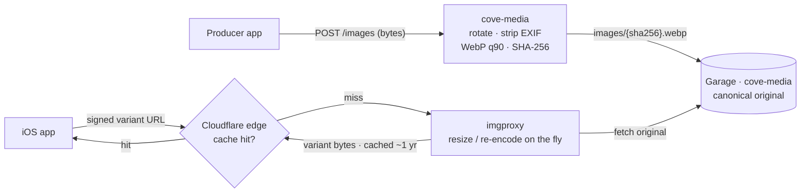

# Media Architecture

> **Status:** Phase 2 complete. `cove-media` is deployed and handling image uploads and signed-URL delivery. The full variant-serving pipeline (imgproxy + Cloudflare CDN) and the Postgres `catalog.media` table are Phase 3 work — those sections document the target design. v1 covers item images only; videos and documents are deferred.

## Contents

- [Overview](#overview)
- [The mental model](#the-mental-model)
- [Data model](#data-model)
- [Variant catalog](#variant-catalog)
- [Serving variants](#serving-variants)
- [Picking variants on iOS](#picking-variants-on-ios)
- [Producer upload flow](#producer-upload-flow)
- [The imgproxy URL — anatomy](#the-imgproxy-url--anatomy)
- [Auth model](#auth-model)
- [Caching](#caching)
- [Pre-warming](#pre-warming)
- [Garbage collection](#garbage-collection)
- [What's deferred](#whats-deferred)
- [References](#references)

---

## Overview

Every item in Cove has at least one image, and most have a small gallery. Those images need to:

- Render fast and crisp on every device size (small iPhone to 4K desktop in a future web client)
- Survive an upload from any producer's camera (HEIC, JPEG, PNG, oddly-rotated, with embedded GPS metadata)
- Cache aggressively at the edge so the cluster doesn't re-do work
- Stay safe from URL abuse without breaking how `` and `AsyncImage` work

This doc describes the system that delivers all of that. For the broader data model — including the polymorphic `media` table and item/producer/place schema — see [Marketplace Architecture](MARKETPLACE_ARCHITECTURE.md); for Postgres mechanics see [Postgres Primer](POSTGRES_PRIMER.md).

---

## Phase 2 signed-URL endpoint — lifecycle

`cove-media` exposes `GET /images/{filename}/url`, which returns a short-lived HMAC-SHA256 signed imgproxy URL (1 hr TTL). This is the endpoint the iOS app calls today via `CoveAPIClient.imageURL(filename:width:height:)`.

**Phase 2 role:** interim mechanism — lets the iOS app fetch images before `cove-catalog` exists to embed signed URLs in its responses.

**Phase 3 onwards:** `cove-catalog` will generate and embed pre-signed variant URLs directly in item list and detail responses. iOS will stop calling `GET /images/{filename}/url` for day-to-day image loading; the signed URL will be available in the response payload alongside the item data.

**Ongoing role:** the endpoint stays deployed and useful for producer-facing preview flows — e.g., preview a just-uploaded image before it is associated with an item.

---

## The mental model

Three pieces, each doing one thing well:

| Piece | Role |
|---|---|
| **Garage** (`cove-media` bucket) | Stores one canonical, high-resolution copy of every uploaded image. S3-compatible, in-cluster. |
| **imgproxy** | Generates resized / re-encoded variants on the fly from the canonical source. Open-source, libvips-backed, runs as a single Deployment in the cluster. |
| **Cloudflare** | Caches every uniquely-URL'd variant at the edge. Once warmed, the cluster never sees that exact URL again. |

The principle that ties them together: **one source of truth, infinite derived views.** Producers upload once. imgproxy turns that one source into whatever shape a screen needs. Cloudflare remembers every shape and serves it from the edge. The cluster pays the transformation cost exactly once per (image, variant) combination.



---

## Data model

Images are stored in the polymorphic `catalog.media` table — one row per image, attached to an item, producer (logo), or place (photo) via an exclusive arc. An item's `primary` image is used in every list view; `gallery` images show up on the detail screen carousel. The **canonical table definition lives in [Marketplace Architecture](MARKETPLACE_ARCHITECTURE.md)**; this doc covers the storage, transformation, and serving pipeline that sits on top of it.

The fields this pipeline relies on: `media_key` (the content-addressed Garage object key), `role` (`primary` / `gallery` / `logo`), `sort_order` (carousel order), `alt_text`, and source `width`/`height` (layout hints for the client).

Notes:

- **`media_key` is content-addressed.** `cove-media` writes objects under `<sha256-of-bytes>.webp`, so the same upload twice never wastes storage and never overwrites a different image.
- **`width` / `height` are source dimensions.** Clients use these to reserve layout space *before* the image loads, eliminating layout shift in list views.
- **No `image_key` column on `catalog.items`.** The primary image is `WHERE role = 'primary'` on this table; list queries pull it via a `LATERAL JOIN`.
- **`ON DELETE CASCADE`.** Deleting an item removes its media rows automatically. (The Garage objects themselves are pruned by a separate cleanup job — see "Garbage collection" below.)

### Why a child table, not multiple columns on `catalog.items`

A `primary_image_key` + `gallery_image_keys jsonb` shape on `catalog.items` would work for v1 but:

- Variable-cardinality gallery items model badly in flat columns
- Sort order would either live in the JSONB (awkward to UPDATE) or require renaming columns
- Cascade behavior is cleaner with a real child table
- Alt text and source dimensions need somewhere structured to live

The child-table cost is one JOIN per item on list queries — indexed, negligible.

---

## Variant catalog

A small, fixed catalog of sizes. Server-defined; clients pick by name.

| Variant | Dimensions | Used for |
|---|---|---|
| `thumb` | 200 × 200 | Search result thumbnails, small grid views (1×) |
| `sm` | 400 × 400 | List views (2×), avatar-like contexts |
| `md` | 800 × 800 | Detail hero (1×) / list views (3× on Pro iPhones) |
| `lg` | 1600 × 1600 | Detail hero / carousel (2×) |
| `xl` | 3200 × 3200 | Retina desktop / future web client |

All variants resize with `fill` mode (crop overflow to exact square dimensions). Output format is WebP for v1; AVIF support can be added with a new variant suffix without disturbing existing URLs.

### Why a fixed catalog, not arbitrary client-requested dimensions

| Aspect | Fixed catalog (chosen) | Arbitrary dimensions |
|---|---|---|
| CDN cache hit rate | Bounded set of URLs per image — predictable | Each unique dimension fragments cache; near-duplicates never share a hit |
| Signing surface | Server signs only catalog URLs; client cannot ask for any other | Server has to sign anything the client asks for, or expose the signing key |
| Forward compatibility | Add a new variant by deploying server config | No central place to manage available sizes |
| iOS implementation | Switch over a known enum | Compute pixel dimensions everywhere |

### Adding a new variant

When the future web client needs `2k` (2048 × 2048) for retina laptops:

1. Add the row to the catalog (single config value in `cove-catalog` / `cove-media`)
2. Server starts including `2k` in response shapes that already return the full set (or add it to specific endpoints)
3. Clients that know about it use it; clients that don't ignore it

No migration. No URL rotation. No cache invalidation.

---

## Serving variants

Response shapes differ by endpoint — list views need one image with a few sizes; detail views need the full gallery with the full size set.

### List endpoint (e.g. search, browse)

OpenAPI schema:

```yaml
ItemSummary:
  properties:
    id:         { type: string, format: uuid }
    name:       { type: string }
    priceCents: { type: integer }
    producerName: { type: string }   # null for brand-only and secondhand items
    primaryImage:
      $ref: '#/components/schemas/ImageVariants'

ImageVariants:
  required: [width, height]
  properties:
    width:   { type: integer }
    height:  { type: integer }
    altText: { type: string }
    thumb:   { type: string, format: uri }
    sm:      { type: string, format: uri }
    md:      { type: string, format: uri }
```

SQL backing it (search query, primary image only):

```sql
SELECT
    p.id, p.name, p.price_cents,
    pr.name AS producer_name,
    img.media_key, img.width, img.height, img.alt_text
FROM catalog.items p
LEFT JOIN directory.producers pr ON pr.id = p.producer_id
LEFT JOIN LATERAL (
    SELECT media_key, width, height, alt_text
    FROM catalog.media
    WHERE item_id = p.id AND role = 'primary'
    LIMIT 1
) img ON TRUE
WHERE p.is_active
  AND p.search_vec @@ websearch_to_tsquery('english', $1)
ORDER BY ts_rank(p.search_vec, websearch_to_tsquery('english', $1)) DESC
LIMIT $2;
```

The Go handler then signs three imgproxy URLs per result (`thumb`, `sm`, `md`) and assembles the response.

### Detail endpoint

OpenAPI schema:

```yaml
ItemDetail:
  properties:
    # ...all the item fields...
    media:
      type: array
      items: { $ref: '#/components/schemas/ItemMedia' }

ItemMedia:
  required: [role, width, height]
  properties:
    role:    { type: string, enum: [primary, gallery] }
    altText: { type: string }
    width:   { type: integer }
    height:  { type: integer }
    variants:
      properties:
        thumb: { type: string, format: uri }
        sm:    { type: string, format: uri }
        md:    { type: string, format: uri }
        lg:    { type: string, format: uri }
        xl:    { type: string, format: uri }
```

SQL fetches the full gallery for the item:

```sql
SELECT id, media_key, role, sort_order, alt_text, width, height
FROM catalog.media
WHERE item_id = $1
ORDER BY sort_order;
```

The handler signs all five variants per media item.

### Payload size

A list response with 25 results × 3 variant URLs (~200 chars each) is ~15 KB just in image URLs — fine over modern mobile networks, cheaper than fetching extra metadata. Detail responses with 6 media items × 5 variants are ~6 KB — also fine.

---

## Picking variants on iOS

The client knows two things: the rendering context (target point size) and the device pixel scale (`UIScreen.main.scale` or the SwiftUI environment equivalent).

```swift
extension ImageVariants {
    /// Pick the smallest variant whose width meets or exceeds the target pixel size.
    /// Falls back to the largest available if the target exceeds the catalog.
    func url(forTargetPointSize size: CGFloat,
             scale: CGFloat = UIScreen.main.scale) -> URL? {
        let target = size * scale
        let candidate: String?
        switch target {
        case ..<300:   candidate = thumb
        case ..<600:   candidate = sm
        case ..<1200:  candidate = md
        case ..<2400:  candidate = lg
        default:       candidate = xl
        }
        return candidate.flatMap(URL.init(string:))
    }
}

// Usage
AsyncImage(url: item.primaryImage.url(forTargetPointSize: 150)) { phase in
    switch phase {
    case .success(let image): image.resizable().scaledToFill()
    case .failure:            Color.gray
    case .empty:              ProgressView()
    @unknown default:         EmptyView()
    }
}
.aspectRatio(
    item.primaryImage.width / item.primaryImage.height,
    contentMode: .fill
)
.frame(width: 150, height: 150)
.clipped()
```

The `width`/`height` from the response means the `AsyncImage` reserves its space before the bytes arrive — no layout shift when the image loads in.

For a future web client, the same response shape maps directly to `<picture>` with `srcset` (no client-side variant-selection logic needed; the browser does it).

---

## Producer upload flow

Producers upload once; the server handles everything that needs to be identical across items.

### Minimum requirements (enforced server-side in `cove-media`)

| Requirement | Value | Why |
|---|---|---|
| Minimum dimensions | 2000 × 2000 | Need clean downscale to `xl` (3200) without upscaling artifacts on retina displays |
| Maximum dimensions | 8000 × 8000 | Cap imgproxy memory/CPU per transformation |
| Maximum file size | 20 MB | Generous for high-quality phone or DSLR shots |
| Accepted formats | JPEG, PNG, WebP | HEIC support is deferred (see "What's deferred" below) |
| Aspect ratio | Any (documented preference: square or 4:3 for catalog browsing) | Server `fill`-crops to square variants regardless |

These are returned in a structured error response when violated so the client can show a useful message ("Image must be at least 2000×2000 pixels").

### Normalization pipeline

After accepting the upload, `cove-media` runs the bytes through libvips before writing to Garage:

```
1. Decode source format            (handles JPEG, PNG, WebP — govips/libvips)
2. Auto-rotate from EXIF flag      (phone photos often have rotation set)
3. Strip EXIF metadata             (privacy: removes GPS coordinates; size win)
4. Re-encode as WebP, quality 90   (high-fidelity, compact)
5. Compute SHA-256 of resulting bytes
6. Write to Garage as images/<sha256>.webp  (bucket: cove-media)
7. Return { key, width, height } to the caller
```

Why each step matters:

- **Strip EXIF** — phone photos embed GPS coordinates by default. Without this, every item image leaks the producer's location.
- **Auto-rotate** — phones store the image with the sensor's native orientation and a separate rotation flag. Without rotating during decode, half the uploads display sideways.
- **WebP quality 90** — visually lossless; ~40-60% smaller than the equivalent JPEG. Cheap storage win.
- **Content-addressed key** — if a producer uploads the same image twice (different items, same source photo), Garage stores one object. If a producer mid-upload retries, we don't pollute storage with half-written objects.

Note: sRGB color-space normalization and HEIC acceptance are deferred to a future iteration (see "What's deferred").

### Associating with an item

Upload is decoupled from item association:

1. Producer app calls `POST /images` with the image bytes → response: `{ media_key, width, height }`
2. Producer app calls `POST /items` (or `PATCH`) with the desired role: `{ media_key, role: 'primary' }`
3. `cove-catalog` inserts into `media`

This split means a producer can upload several images and then arrange them — no need for the upload endpoint to know about items.

---

## The imgproxy URL — anatomy

Every variant URL the server returns looks like this:

```
https://api.coveapp.dev/i/<sig>/rs:fill:600:600/plain/s3://cove-media/<key>.webp@webp
└─────┬──────────┘  └┬┘ └─┬┘ └──────┬───────┘  └──┬──┘ └──────┬──────────┘  └─┬─┘
   public host       │  signature  processing      source     S3 source URL    output
                    path           options          format    (Garage)        format
                    prefix
```

| Component | What it does |
|---|---|
| `https://api.coveapp.dev` | Public hostname (Cloudflare Tunnel) |
| `/i/` | Path prefix routed to imgproxy via cove-api. **Not Bearer-authenticated** — see [Auth model](#auth-model) below. |
| `<sig>` | HMAC-SHA256 signature over the path. Server-side secret. Prevents URL forgery. |
| `rs:fill:600:600` | imgproxy processing options. `rs` = resize, `fill` = crop to fill exact dimensions. Other options chainable: `rs:fill:600:600/q:80/bg:fff`. |
| `plain/` | Source URL format mode. `plain` keeps the source URL human-readable; alternative is base64. |
| `s3://cove-media/<key>.webp` | The source for imgproxy to fetch. imgproxy is configured (via env) to resolve `s3://` against the in-cluster Garage endpoint. |
| `@webp` | Output format. imgproxy transcodes to this regardless of source format. |

### Signing in Go

```go
type ImgproxyClient struct {
    PublicBaseURL string  // "https://api.coveapp.dev"
    Key           []byte  // IMGPROXY_KEY (from ESO secret)
    Salt          []byte  // IMGPROXY_SALT (from ESO secret)
}

func (c *ImgproxyClient) SignedURL(bucket, key, variant string) string {
    width, height := variantDimensions(variant)  // looks up the catalog
    path := fmt.Sprintf(
        "/rs:fill:%d:%d/plain/s3://%s/%s@webp",
        width, height, bucket, key,
    )
    mac := hmac.New(sha256.New, c.Key)
    mac.Write(c.Salt)
    mac.Write([]byte(path))
    sig := base64.RawURLEncoding.EncodeToString(mac.Sum(nil))
    return fmt.Sprintf("%s/i/%s%s", c.PublicBaseURL, sig, path)
}
```

The signing key + salt are 32+ byte random values stored in GCP Secret Manager and synced into the cluster via ExternalSecret. The same values are mounted into the imgproxy Deployment as `IMGPROXY_KEY` and `IMGPROXY_SALT`.

If the keys ever drift, every URL signed with one fails verification on the other — a clear, loud failure mode (every image returns 403).

---

## Auth model

This is the most nuanced part of the architecture. Image URLs need to coexist with three constraints:

1. **Cloudflare wants to cache by URL.** Per-user URLs destroy hit rate.
2. **`` and `AsyncImage` don't add auth headers.** Custom URLSession wiring at every image-loading site is unworkable.
3. **The catalog is a marketplace.** Item images are inherently meant to be seen by potential buyers.

### The four options

| Option | How it works | CDN-friendly | Right for |
|---|---|---|---|
| **A. Public signed URLs** | Signature makes URL unguessable; anyone with the URL can fetch | ✅ Yes — same URL for all users | Public catalog images |
| **B. Per-user signed URLs** | Server signs with user UID embedded; each user gets a unique URL | ❌ No — cache fragments per user | Private documents per user |
| **C. Short-lived signed URLs** | Signature includes expiration; URL works for a window (e.g. 1 hour) | ⚠️ Within the validity window, yes; URLs rotate when keys do | Producer drafts, time-limited access |
| **D. Token-protected URLs** | Every fetch requires a Bearer header | ❌ No — every user pays full transformation cost | Genuinely private data with no cacheability requirement |

### Recommendation for Cove

**Per-image-class strategy:**

| Image class | Strategy | Expiry |
|---|---|---|
| Active catalog (`is_active = true` on the item) | Option A — public signed | Effectively unlimited |
| Producer drafts (`is_active = false`, not yet published) | Option C — short-lived signed | 1 hour, refreshed via authenticated endpoint |
| Truly private (future: producer verification documents, receipts) | Option D — token-protected | Per-request auth, no CDN |

The implementation is straightforward: `cove-catalog` checks the item state when constructing the URL and decides which signing mode to use. imgproxy's `IMGPROXY_TOKEN_EXP` config supports verifying the expiry portion of the signature.

### "But the catalog is auth-only — why is the image URL public?"

Image **URLs** are public; the **API that produces them** is not. To discover an item image's URL, a client must first call `/items/search` or `/items/{id}` with a valid Firebase ID Token. The Bearer-token check at `cove-api` happens *before* the URL is returned.

Once a URL is in hand, anyone can fetch the bytes — but the URL is unguessable (HMAC-SHA256 signature), and you can't enumerate them without going through the authenticated API. This is the same pattern Etsy, Shopify places, Amazon product images, and every major marketplace uses. Authenticated image serving is reserved for things like medical records, financial documents, and other categories where bytes leaking would be a real harm — not for item catalog images.

---

## Caching

The architecture is layered specifically so the cluster does each transformation **once, ever**:

```
Layer        Caches                          Lifetime
─────        ──────                          ────────
Cloudflare   Variant URL → variant bytes     1 year (immutable URLs)
imgproxy     (none; relies on Cloudflare)    —
Cluster      Garage → original bytes         indefinite
```

### Cache hit rate

For a typical catalog browse session:
- First user to view item X at variant `md`: imgproxy transforms (~30-80ms libvips), Cloudflare caches
- Every subsequent user requesting the same variant URL: served from Cloudflare edge (~10-30ms total round-trip), cluster never sees the request

Because URLs are deterministic (same source key + same variant = same URL across all callers), every item's variants converge to the cache quickly. The cluster's imgproxy pod handles a small, bounded number of transformations: **(images uploaded) × (variants in catalog)**. At 1,000 items with 5 images each and a 5-variant catalog, that's 25,000 transformations across the lifetime of the item. Negligible.

### Cache headers from imgproxy

The Cloudflare edge cache doesn't kick in automatically for our URL pattern — the path ends in `@webp` (imgproxy's output format suffix), not `.webp`, so Cloudflare's static-asset extension heuristic doesn't match. What actually triggers caching is the **origin response headers** imgproxy sends:

```http
Cache-Control: public, max-age=31536000, immutable
ETag: "<sha256-of-bytes>"
```

Cloudflare's default "Respect Origin Headers" behavior on the Free plan caches based on these regardless of URL pattern. `immutable` tells Cloudflare (and browser caches) that the URL's response will never change — they can serve from cache without revalidation. This is safe because the URL itself encodes the content (via `media_key` = SHA-256 of source bytes). If the source changes, it gets a new key, which produces new URLs.

### Cloudflare configuration

The Free plan covers everything we need: edge caching, ~~unlimited~~ bandwidth, basic DDoS protection. The paid features (Argo Smart Routing, Tiered Cache, Cache Reserve) trim 20-30ms off transit and matter at much higher traffic — they're not load-bearing for Cove.

Optionally, a single Cache Rule in the Cloudflare dashboard provides belt-and-suspenders coverage and lets you override TTL without redeploying imgproxy:

- **Match:** Hostname is `api.coveapp.dev` AND URI Path matches `/i/*`
- **Action:** Eligible for cache, Edge TTL 1 year

Free plan allows up to 5 Cache Rules. With the origin headers above already doing the work, this rule is optional.

### When does the cache miss?

- First request for a (source, variant) combination since deployment
- A new variant is added to the catalog
- The signing key rotates (every URL becomes invalid → forces re-signing on the server and re-fetching by clients)

The first two are normal cache-warm scenarios. The third is operationally significant: rotate keys rarely (or not at all), and have a plan if you need to.

---

## Pre-warming

Optionally, `cove-media` can pre-warm Cloudflare's cache right after a successful upload:

```go
go func(key string) {
    for _, variant := range []string{"thumb", "sm", "md", "lg", "xl"} {
        url := imgproxy.SignedURL(bucket: "cove-media", key, variant)
        // HEAD request: warms Cloudflare's cache without downloading bytes
        _, _ = http.Head(url)
    }
}(key)
```

Errors are ignored — if pre-warming fails, the first real user request just triggers a normal cache miss and continues. This is purely opportunistic optimization to make the first user of a new item see snappy load times.

For items with very high traffic, the variants stay warm at the Cloudflare edge naturally; pre-warming is mostly useful for the long tail (new items, infrequently-viewed items where the cache might have evicted).

---

## Garbage collection

When an item is deleted, `ON DELETE CASCADE` removes its `media` rows. The Garage objects themselves are **not** automatically removed — we want to keep them briefly in case a producer changes their mind, and content-addressing means the same image might still be referenced by another item.

A small periodic job sweeps unreferenced objects:

```sql
-- Find Garage keys referenced by no media row.
-- Run weekly; delete objects older than 30 days that don't appear in this query.
SELECT DISTINCT media_key FROM catalog.media;
```

The job lists Garage objects, diffs against the SELECT, and deletes any object that is:
- Not referenced in `media`
- Older than 30 days (gives producers a window to recover)

This stays out of the hot path entirely.

---

## What's deferred

These are real future requirements but explicitly out of scope for v1:

- **HEIC input** — iPhone's default capture format. govips supports it when built with HEIC support; defer until producer upload UX exists and we can test end-to-end.
- **sRGB color-space normalization** — Adobe RGB and P3 sources render with shifted colors when imgproxy converts at delivery time. Normalizing on upload avoids surprises; deferred because most phone uploads are already sRGB.
- **Videos** — would need a separate pipeline (HLS/DASH transcoding, manifest generation, per-bandwidth renditions). No imgproxy equivalent for video that fits this stack cleanly.
- **Documents** (producer certifications, ingredient lists as PDFs) — would use Option D (token-protected, no transformation, just signed-URL serving).
- **Watermarking** — imgproxy supports it; not a v1 requirement.
- **AI-driven cropping** (face detection, salient-object detection) — imgproxy supports `gravity:smart`; defer until v1 catalog shows it's needed.
- **AVIF output** — modern format, ~20% smaller than WebP. Add as a new variant suffix when iOS / web client adoption justifies the imgproxy CPU cost increase.
- **Per-producer signing keys** — would let us revoke one producer's image access without rotating the global key. Defer until producer portal exists.

Each of these can slot in without disturbing the v1 architecture — add a new endpoint, new variant, new field on `media`, or new background job. The data model and serving model don't need to change to accommodate them.

---

## References

- [Marketplace Architecture](MARKETPLACE_ARCHITECTURE.md) — the canonical data model (service layout, schema, polymorphic media table)
- [Postgres Primer](POSTGRES_PRIMER.md) — Postgres mechanics
- [Backend Infrastructure](BACKEND_INFRASTRUCTURE.md) — cluster topology, deployment, Garage
- [imgproxy documentation](https://docs.imgproxy.net/) — full options reference, signing details, deployment guides
